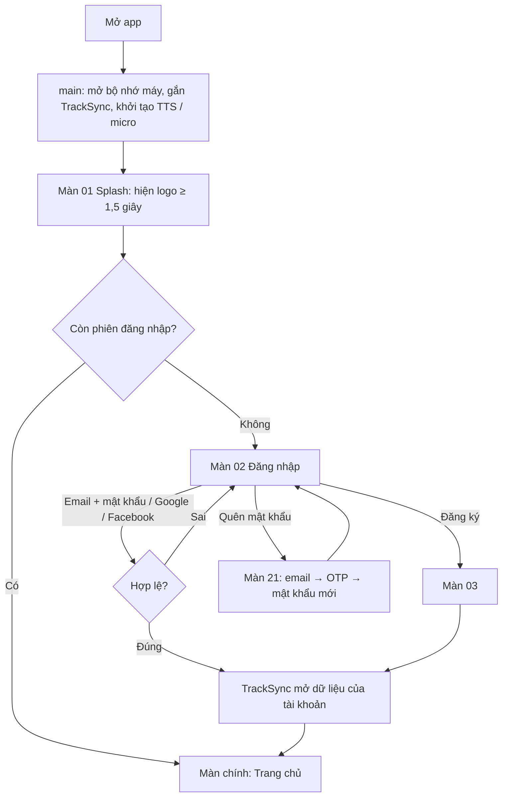
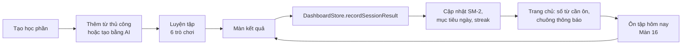
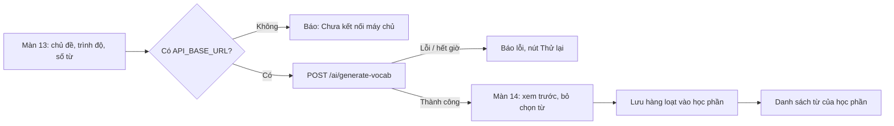

# KarVocab — Ứng dụng học từ vựng tiếng Anh

> **Học phần:** INT1449 · Lập trình thiết bị di động
> **Nhóm thực hiện:** Nhóm 03 — Học viện Công nghệ Bưu chính Viễn thông (PTIT)
> **Đề tài:** Ứng dụng di động học từ vựng tiếng Anh theo phương pháp lặp lại ngắt quãng (SM-2), có tạo từ vựng bằng AI

KarVocab giúp người học tự xây bộ từ vựng theo chủ đề, luyện qua 6 trò chơi, rồi ôn lại đúng lúc sắp quên nhờ thuật toán SM-2. Repo gồm app di động **Flutter** (`karvocab_flutter/`) và **backend NestJS** (`backend/`).

App chạy được ở hai chế độ:

| Chế độ | Cách chạy | Đăng nhập / mật khẩu | Tạo từ bằng AI | Học phần, từ vựng, tiến độ |
| --- | --- | --- | --- | --- |
| **Ngoại tuyến** (mặc định) | `flutter run` | Lưu trên máy (mật khẩu băm SHA-256 + muối) | Không dùng được | Lưu trên máy |
| **Nối backend** | `flutter run --dart-define=API_BASE_URL=...` | Gọi backend (JWT) | Gọi backend (Gemini hoặc mock) | Vẫn lưu trên máy |

> Ở cả hai chế độ, học phần, từ vựng và tiến độ học đều lưu trên máy (`shared_preferences`), tách riêng theo từng tài khoản. Backend đã có API cho phần này nhưng app chưa đồng bộ lên (xem [Giới hạn hiện tại](#-giới-hạn-hiện-tại)).

---

## 📑 Mục lục

1. [Bắt đầu nhanh](#-bắt-đầu-nhanh)
2. [Tính năng](#-tính-năng)
3. [Luồng hoạt động và logic](#-luồng-hoạt-động-và-logic)
4. [Công nghệ](#-công-nghệ)
5. [Cấu trúc repository](#-cấu-trúc-repository)
6. [Kiến trúc app Flutter](#-kiến-trúc-app-flutter)
7. [Cài đặt và chạy app trên máy tính](#-cài-đặt-và-chạy-app-trên-máy-tính)
8. [Chạy trên điện thoại Android thật](#-chạy-trên-điện-thoại-android-thật)
9. [Chạy trên iPhone](#-chạy-trên-iphone)
10. [Chạy backend](#-chạy-backend)
11. [Kiểm thử](#-kiểm-thử)
12. [Giới hạn hiện tại](#-giới-hạn-hiện-tại)
13. [Quy trình làm việc nhóm](#-quy-trình-làm-việc-nhóm)
14. [Tài liệu](#-tài-liệu)

---

## ⚡ Bắt đầu nhanh

```bash
cd karvocab_flutter
flutter pub get
flutter run -d chrome          # chạy thử trên trình duyệt
flutter run                    # chạy trên điện thoại đang cắm cáp (xem mục 8)
```

Tài khoản demo (chế độ ngoại tuyến): `learner@karvocab.com` / `Karvocab1`. Hoặc bấm **Đăng ký** để tạo tài khoản mới. App bắt đầu trống, không có học phần mẫu.

---

## ✨ Tính năng

Số màn hình theo `docs/karvocab/FE-SPECIFICATION.md`.

### Tài khoản
- **Khởi động (Màn 01):** khôi phục phiên đăng nhập trước; chưa đăng nhập thì vào màn Đăng nhập.
- **Đăng nhập / Đăng ký (Màn 02, 03):** kiểm tra định dạng email. Mật khẩu tối đa 72 ký tự; khi đăng ký cần ít nhất 8 ký tự, 1 chữ hoa và 1 chữ số. Họ tên 2–50 ký tự. Nhấn Enter để gửi form.
- **Đăng nhập Google / Facebook:** hiện là bản giả lập (mock), cả khi ngoại tuyến lẫn khi backend chạy `SOCIAL_AUTH_MODE=mock`.
- **Quên mật khẩu (Màn 21):** nhập email, nhận OTP 6 số (hiệu lực 5 phút), đếm ngược 60 giây trước khi được gửi lại, rồi đặt mật khẩu mới. Ở chế độ ngoại tuyến, mã OTP hiện ngay trên màn hình.
- **Dữ liệu riêng từng tài khoản:** nhiều người dùng chung một máy không thấy học phần hay tiến độ của nhau.

### Trang chủ (Màn 04, 16)
- Lời chào, chuỗi ngày học (streak), số từ đã học, số từ cần ôn.
- Thanh mục tiêu hôm nay, biểu đồ hoạt động 7 ngày trong tuần, danh sách học phần gần đây.
- **Ôn tập hôm nay (Màn 16):** ôn các từ đến hạn theo SM-2, xen kẽ 4 dạng câu hỏi (nghe chọn, nghe điền, chọn nghĩa, nhớ từ qua nghĩa).
- **Chuông thông báo:** nhắc khi có từ đã học đến hạn ôn; có đánh dấu đã đọc.

### Thư viện & từ vựng (Màn 05, 06, 07, 09, 22, 24, 28)
- Tạo, sửa, xoá học phần theo chủ đề (Học thuật, Sự nghiệp, Đời sống, Du lịch…). Tên học phần 2–50 ký tự. Có tìm kiếm và lọc.
- Thêm / sửa từ gồm: từ tiếng Anh, nghĩa tiếng Việt, từ loại, trình độ CEFR (A1–C2), phiên âm IPA, câu ví dụ, từ đồng nghĩa / trái nghĩa (nhập dạng thẻ, ngăn bằng dấu phẩy), ghi chú.
- Chi tiết từ: phát âm bằng TTS của thiết bị, tiến độ học (cấp 0–5, ngày ôn tiếp theo).
- Xoá từ có hộp xác nhận và nút **Hoàn tác**; hoàn tác trả từ về đúng vị trí cũ.

### Tạo từ vựng bằng AI (Màn 13, 14) — cần backend
- Nhập chủ đề (tiếng Anh hoặc tiếng Việt), chọn trình độ và số từ; AI gợi ý danh sách từ.
- Xem trước, bỏ chọn từ không muốn, rồi lưu hàng loạt vào học phần.

### Luyện tập (Màn 08, 10, 11, 12, 19, 20, 25, 26)
- Chọn học phần, trạng thái từ (Chưa thuộc / Đã thuộc / Tất cả), số câu (10 / 20 / 30 / 50), thứ tự (A–Z hoặc ngẫu nhiên), thời gian mỗi câu (10–120 giây), âm lượng.
- **6 trò chơi:**

  | Trò chơi | Người học thấy | Cách trả lời | Thời gian mặc định |
  | --- | --- | --- | --- |
  | Nghe và chọn từ | Nghe phát âm | Chọn 1 trong 4 từ | 25 giây |
  | Nghe và điền từ | Nghe phát âm (nghe lại được) | Gõ từ | 40 giây |
  | Chọn nghĩa đúng | Từ tiếng Anh | Chọn 1 trong 4 nghĩa tiếng Việt | 35 giây |
  | Nhớ từ qua nghĩa | Nghĩa tiếng Việt | Gõ từ tiếng Anh | 45 giây |
  | Đồng nghĩa và trái nghĩa | Một từ và một từ khác | Chọn "đồng nghĩa" hay "trái nghĩa" | 20 giây |
  | Luyện phát âm | Từ cần đọc | Đọc vào micro | 30 giây |

- Phản hồi đúng / sai bằng màu, âm thanh và rung; trả lời sai thì hiện đáp án đúng.
- Màn kết quả: điểm, số câu đúng / sai, thời gian; nút **Luyện lại câu sai**.

### Hồ sơ & cài đặt (Màn 15, 23)
- Hồ sơ: tên, email, ngày sinh. Cập nhật ngày sinh thì được cấp **mã ID** (`KM` + năm/tháng/ngày sinh + số thứ tự, vd `KM05092000`), có nút sao chép.
- Thành tựu: số từ đã học, chuỗi ngày, số học phần.
- Huy hiệu: **Chuỗi 7 ngày**, **100 từ đầu tiên**, **Nhà thám hiểm** (6 học phần).
- Cài đặt: mục tiêu số từ mỗi ngày (5–30), bật / tắt và chọn giờ nhắc học, đổi mật khẩu, đăng xuất (có xác nhận).
- **Hướng dẫn & Trợ giúp**, **Điều khoản & Quyền riêng tư** (mở được cả từ màn Đăng nhập).

### Khác
- Giao diện tiếng Việt, kể cả lịch chọn ngày và đồng hồ chọn giờ (`flutter_localizations`, locale `vi`).
- Mọi nút bấm và ô nhập có vùng chạm ≥ 48dp.
- Nút **Back** của Android: ở tab khác thì về Trang chủ; đang làm bài thì hỏi trước khi thoát.
- Dữ liệu còn nguyên sau khi tải lại trang hoặc mở lại app.

---

## 🔄 Luồng hoạt động và logic

### 1. Khởi động và đăng nhập



- **Ngoại tuyến:** tài khoản lưu ở khoá `auth.accounts`, phiên ở `auth.session`. Mật khẩu chỉ lưu dưới dạng băm SHA-256 kèm muối riêng của từng tài khoản.
- **Nối backend:** `/auth/login`, `/auth/register`, `/auth/social-login` trả về access token và refresh token. `ApiClient` tự gọi `/auth/refresh` khi access token hết hạn. Cặp token được lưu xuống máy (`auth.tokens`). Mở lại app thì màn Splash nạp lại token và gọi `/auth/me`: BE từ chối thì quay về màn đăng nhập, còn mất mạng thì vẫn vào app bằng hồ sơ đã lưu.
- **Quên mật khẩu:** ngoại tuyến thì app tự sinh OTP 6 số (hiệu lực 5 phút) và hiện lên màn hình. Nối backend thì gọi `/auth/forgot-password` (backend gửi mail); mã người dùng nhập được gửi kèm `/auth/reset-password`.
- **Tách dữ liệu theo tài khoản:** khi đăng nhập hoặc đăng xuất, `TrackSync` gọi `switchUser(email)` cho `CollectionStore` và `DashboardStore`. Hai store đọc khoá có hậu tố tài khoản, ví dụ `library.collections@an@gmail.com`. Đăng xuất thì dữ liệu trên màn hình được xoá khỏi bộ nhớ RAM, còn dữ liệu trên máy vẫn giữ để lần sau đăng nhập lại.

### 2. Luồng học chính



### 3. Một phiên luyện tập

1. **Chọn bộ từ (Màn 10):** gom từ của các học phần đã chọn, lọc theo trạng thái (Chưa thuộc / Đã thuộc / Tất cả), sắp A–Z hoặc xáo ngẫu nhiên, lấy đủ số câu.
   - Không còn từ nào phù hợp: báo *"Không có từ phù hợp…"*.
   - Trò Đồng nghĩa / trái nghĩa mà các từ chưa có từ đồng nghĩa / trái nghĩa: báo trước, không vào trò.
2. **Tạo câu hỏi (`QuizQuestionFactory`):** câu trắc nghiệm có 1 đáp án đúng và tối đa 3 đáp án nhiễu, ưu tiên lấy từ cùng từ loại, xáo vị trí A/B/C/D.
3. **Làm bài (`QuizController`):**
   - Mỗi câu có đồng hồ đếm ngược; còn 5 giây thì phát tiếng tích tắc; hết giờ thì câu đó tính **sai**.
   - **Chấm câu gõ chữ:** bỏ khoảng trắng thừa, không phân biệt hoa thường. Đúng hoàn toàn là **Đúng**. Sai đúng 1 ký tự (khoảng cách Levenshtein = 1) với từ dài ≥ 3 là **Suýt đúng**, vẫn tính đúng nhưng nhắc chính tả. Còn lại là **Sai**.
   - **Luyện phát âm:** máy nhận dạng giọng nói trả về vài phương án nghe được; app chấm từng phương án bằng luật trên và lấy kết quả tốt nhất. Không nghe được gì thì cho bỏ qua câu (tính sai).
   - Bấm Back khi đang làm bài: hỏi xác nhận trước khi thoát.
4. **Kết thúc:** hiện màn kết quả, rồi gọi `recordSessionResult` để lưu tiến độ. Nút **Luyện lại câu sai** tạo phiên mới chỉ gồm các câu vừa làm sai.

### 4. Thuật toán SM-2 (ôn tập ngắt quãng)

Mỗi từ có một bản ghi tiến độ `SrsProgress`: cấp (0–5), khoảng cách ngày, hệ số dễ (ease, 1,3–2,5), ngày ôn tiếp theo, đã thuộc hay chưa.

| Kết quả câu trả lời | Cấp mới | Ôn lại sau | Hệ số dễ |
| --- | --- | --- | --- |
| Đúng (cấp 0 → 1) | 1 | 1 ngày | +0,1 (tối đa 2,5) |
| Đúng (cấp 1 → 2) | 2 | 3 ngày | +0,1 |
| Đúng (cấp 2 → 3) | 3 | 7 ngày | +0,1 |
| Đúng (cấp 3 → 4) | 4 | 16 ngày | +0,1 |
| Đúng (cấp 4 → 5) | 5 = **Đã thuộc** | 35 ngày | +0,1 |
| Sai | 0 | 1 ngày | −0,2 (tối thiểu 1,3) |

Các luật chống "học dồn" (giống backend, `applySession`):
- Trong một phiên, mỗi từ chỉ tính **câu trả lời đầu tiên**.
- Trả lời đúng chỉ lên cấp khi từ **là từ mới hoặc đã đến hạn ôn**. Trả lời đúng một từ chưa đến hạn thì không đổi gì.
- Trả lời sai thì luôn về cấp 0, kể cả khi từ chưa đến hạn.
- Từ đã thuộc vẫn được hẹn ôn lại sau 35 ngày.

**Danh sách cần ôn** (`dueVocabularies`) gồm từ mới chưa học và từ có ngày ôn ≤ hiện tại, sắp theo hạn sớm nhất. **Ôn tập hôm nay (Màn 16)** lấy danh sách này và trộn 4 dạng câu hỏi không cần micro và không cần dữ liệu đồng nghĩa.

### 5. Mục tiêu ngày, streak, huy hiệu

- **Mục tiêu ngày:** đếm số từ **khác nhau** có ít nhất một câu đúng trong các phiên hôm nay (kể cả phiên luyện lại câu sai). So với mục tiêu đặt trong Cài đặt (5–30, mặc định 10). Số này cũng là cột của ngày hôm nay trên biểu đồ tuần.
- **Streak:** mỗi ngày có ít nhất một phiên đã nộp thì tăng tối đa 1. Học liền ngày hôm qua thì cộng tiếp, không thì bắt đầu lại từ 1. Bỏ trọn một ngày thì streak hiện 0. Ngày tính theo giờ địa phương của máy.
- **Huy hiệu:** Chuỗi 7 ngày (streak cao nhất ≥ 7), 100 từ đầu tiên (đã học ≥ 100 từ), Nhà thám hiểm (≥ 6 học phần).
- `TrackSync` đồng bộ mục tiêu ngày từ Cài đặt sang Trang chủ, và streak từ Trang chủ sang Hồ sơ.

### 6. Thông báo nhắc ôn

- Chuông ở Trang chủ chỉ có thông báo khi có **từ đã học** đến hạn ôn (từ mới chưa học không tính). Bấm vào thông báo thì mở Ôn tập hôm nay.
- Trạng thái "đã đọc" lưu riêng cho từng tài khoản (khoá `notifications.read@<email>`).
- Giờ nhắc học trong Cài đặt hiện chỉ được lưu lại, chưa bắn thông báo của hệ điều hành (xem [Giới hạn hiện tại](#-giới-hạn-hiện-tại)).

### 7. Tạo từ bằng AI



Backend chọn nhà cung cấp AI theo biến `AI_PROVIDER`: `mock` (mặc định, chạy không cần key) hoặc `gemini`.

### 8. Dữ liệu lưu trên máy

| Khoá | Nội dung | Theo tài khoản |
| --- | --- | --- |
| `auth.accounts` | Danh sách tài khoản (họ tên, mật khẩu băm + muối, ngày sinh, mã ID, mục tiêu, giờ nhắc) | — |
| `auth.session` | Tài khoản đang đăng nhập | — |
| `library.collections@<email>` | Học phần | ✓ |
| `library.vocabularies@<email>` | Từ vựng | ✓ |
| `dashboard.state@<email>` | Tiến độ SM-2 từng từ, streak, lịch sử 7 ngày, mục tiêu | ✓ |
| `notifications.read@<email>` | Thông báo đã đọc | ✓ |
| `quiz.settings` | Thời gian mỗi câu, âm lượng | — |

Trên web, các khoá này nằm trong localStorage với tiền tố `flutter.`. Dữ liệu hỏng (bị sửa tay, đổi định dạng) được coi như chưa có, nên app không bị crash.

---

## 🛠 Công nghệ

| Phần | Công nghệ |
| --- | --- |
| App | Flutter 3.50 (Dart SDK `^3.13.5`), Material 3 |
| Quản lý trạng thái | `ChangeNotifier` + `ListenableBuilder` (không dùng BLoC / Provider) |
| Lưu trên máy | `shared_preferences` (SharedPreferences trên Android, localStorage trên web) |
| Âm thanh | `flutter_tts` (đọc từ), `audioplayers` (hiệu ứng), `speech_to_text` (luyện phát âm) |
| Mạng / bảo mật | `http`, `crypto` (băm mật khẩu ở chế độ ngoại tuyến) |
| Backend | NestJS 11, TypeScript, Prisma 6, PostgreSQL 15, Redis 7, BullMQ, Swagger |
| AI | Google Gemini (`@google/genai`) qua backend; mặc định chạy mock |
| CI | GitHub Actions (`.github/workflows/backend-ci.yml`) cho backend |

---

## 📂 Cấu trúc repository

```text
INT1449_Nhom3_KTHP/
├── karvocab_flutter/            # App di động Flutter
│   ├── lib/
│   │   ├── main.dart            # Khởi tạo bộ nhớ, gắn TrackSync, theme, locale vi
│   │   ├── core/                # Dùng chung, không phụ thuộc data / presentation
│   │   │   ├── config/          #   api_config.dart: đọc API_BASE_URL
│   │   │   ├── constants/       #   màu, kích thước, thời lượng, chuỗi UI, từ loại
│   │   │   ├── theme/           #   theme, typography, shadows
│   │   │   ├── utils/           #   validators, fuzzy_match (Levenshtein), lịch ôn, mã ID, ngày
│   │   │   └── widgets/         #   AppButton, AppTextField, toast, CEFR badge, streak flame...
│   │   ├── data/
│   │   │   ├── local/           #   LocalStore (Prefs / Memory), StorageKeys
│   │   │   ├── models/          #   Collection, Vocabulary, UserProfile, Quiz, Badge, AI draft
│   │   │   ├── remote/          #   ApiClient (JWT, refresh), RemoteAiVocabRepository
│   │   │   ├── repositories/    #   AuthRepository, CollectionStore, DashboardStore (SM-2),
│   │   │   │                    #   QuizQuestionFactory, QuizSettingsStore, TrackSync...
│   │   │   └── services/        #   TTS, nhận dạng giọng nói, phát âm, âm thanh / rung, nhắc học
│   │   └── presentation/
│   │       ├── screens/         #   Splash, Login, MainShell, Home, Library, WordList,
│   │       │                    #   WordDetail, WordForm, Profile, Settings, Info, ForgotPassword
│   │       ├── quiz/            #   Chọn chế độ, phiên quiz, kết quả, 6 dạng câu hỏi
│   │       ├── ai_vocab/        #   Tạo từ bằng AI + xem trước
│   │       ├── dashboard/       #   Ôn tập hôm nay (Màn 16)
│   │       ├── forgot_password/ #   Luồng OTP
│   │       ├── home/ library/ notifications/   # UI state + controller
│   │       └── widgets/         #   Bottom nav, form học phần, ô nhập thẻ, biểu đồ tuần...
│   ├── test/                    # Unit + widget test; dữ liệu mẫu chỉ có trong test/fixtures
│   ├── assets/                  # Logo, linh vật, âm thanh, icon học phần
│   ├── docs/ai/prompt_log.md    # Nhật ký sử dụng AI
│   └── android/ ios/ web/ windows/ macos/ linux/
├── backend/                     # API NestJS (xem backend/README.md)
│   ├── src/modules/             # auth, users, collections, vocabularies, ai, audio, quiz,
│   │                            # spaced-repetition, streak, gamification, dashboard,
│   │                            # notifications, sync, storage, mail, health
│   ├── prisma/                  # schema, migrations, seed
│   └── docker-compose.yml       # PostgreSQL :5433, Redis :6380, pgAdmin (tuỳ chọn)
├── docs/
│   ├── karvocab/
│   │   ├── FE-SPECIFICATION.md  # Đặc tả 28 màn hình, design tokens, chia FE1 / FE2
│   │   ├── BE-SPECIFICATION.md  # ERD, REST API, thuật toán SM-2
│   │   └── FE-BE-ALIGNMENT.md   # Những điểm FE cần khớp với BE
│   └── superpowers/plans/       # Kế hoạch triển khai backend
└── .github/workflows/           # CI backend
```

---

## 🧱 Kiến trúc app Flutter

```text
presentation  ──►  data  ──►  core
 (màn hình,        (store,      (hằng số, theme,
  controller)       model,       tiện ích, widget
                    API, máy)    dùng chung)
```

- **Store dạng singleton có thể thay khi test:** `AuthRepository.instance`, `CollectionStore.instance`, `DashboardStore.instance`... Màn hình nhận store qua tham số tuỳ chọn, nên test truyền store riêng chạy trên `MemoryLocalStore`.
- **Giao diện tự cập nhật:** store là `ChangeNotifier`; màn hình bọc bằng `ListenableBuilder` nên dữ liệu đổi ở đâu thì mọi màn đang mở đều vẽ lại.
- **`LocalStore`:** `PrefsLocalStore` khi chạy thật, `MemoryLocalStore` khi test (mỗi lần chạy test bắt đầu trống).
- **`TrackSync`:** cầu nối giữa phần của FE1 (tài khoản, thư viện) và FE2 (trang chủ, luyện tập): chuyển dữ liệu theo tài khoản, đồng bộ mục tiêu ngày và streak.
- **`ApiClient`:** chỉ được tạo khi có `API_BASE_URL`; tự gắn access token và gọi `/auth/refresh` khi token hết hạn.

App hiện gọi các API: `/auth/login`, `/auth/register`, `/auth/social-login`, `/auth/refresh`, `/auth/logout`, `/auth/forgot-password`, `/auth/reset-password`, `/users/password`, `/ai/generate-vocab`.

---

## 🚀 Cài đặt và chạy app trên máy tính

### Yêu cầu
- **Flutter SDK 3.50 trở lên** (Dart `^3.13.5`). Cài theo hướng dẫn tại flutter.dev, thêm `flutter\bin` vào biến `PATH`.
- **Android Studio**: dùng để cài Android SDK, JDK và máy ảo. Khi mở lần đầu, chọn cài *Android SDK*, *Android SDK Platform-Tools*, *Android SDK Command-line Tools*.
- **Chrome** nếu muốn chạy bản web.
- Chạy `flutter doctor` và xử lý hết các dòng ✗ liên quan Android (xem mục 8, bước 0).

### Chạy
```bash
cd karvocab_flutter
flutter pub get                 # tải thư viện (chạy lại mỗi khi pubspec.yaml đổi)

flutter run -d chrome           # web
flutter run -d windows          # app Windows (cần Visual Studio có "Desktop development with C++")
flutter emulators --launch <tên>  # mở máy ảo Android đã tạo trong Android Studio
flutter run                     # chạy lên máy ảo / điện thoại đang kết nối

# Nối backend
flutter run -d chrome --dart-define=API_BASE_URL=http://localhost:3100/api/v1
flutter run --dart-define=API_BASE_URL=http://10.0.2.2:3100/api/v1   # máy ảo Android: 10.0.2.2 = máy tính
```

Phím tắt khi `flutter run` đang chạy: `r` nạp lại nhanh (hot reload), `R` khởi động lại app, `q` thoát.

### Build bản phát hành
```bash
flutter build apk --release      # build/app/outputs/flutter-apk/app-release.apk
flutter build web --release      # build/web
# Thêm --dart-define=API_BASE_URL=... nếu muốn bản build nối backend
```

Đổi icon app (sinh từ `assets/images/logoapp.webp`): `dart run flutter_launcher_icons`.

---

## 📱 Chạy trên điện thoại Android thật

Có hai cách:

| | Cách 1: Cắm cáp USB | Cách 2: Cài file APK |
| --- | --- | --- |
| Khi nào dùng | Đang phát triển, cần sửa và xem ngay | Cài cho cả nhóm / giảng viên thử, không cần máy tính bên cạnh |
| Cập nhật code | Bấm `r` là điện thoại cập nhật ngay | Phải build và cài lại APK |
| Cần cáp | Có (hoặc Wi-Fi, xem 1b) | Không |

### Bước 0: Chuẩn bị máy tính (làm một lần)

1. Kiểm tra môi trường:
   ```bash
   flutter doctor
   ```
2. Nếu dòng **Android toolchain** báo *"Android license status unknown"*, chấp nhận license Android SDK (gõ `y` cho từng mục):
   ```bash
   flutter doctor --android-licenses
   ```
3. Chạy lại `flutter doctor`; dòng **Android toolchain** phải có dấu ✓.
4. Lần build Android đầu tiên Gradle tải nhiều thư viện nên mất khoảng **5 phút**; các lần sau nhanh hơn nhiều.

### Cách 1: Cắm cáp USB

**Bước 1 — Bật Tuỳ chọn nhà phát triển trên điện thoại.** Vào **Cài đặt → Thông tin điện thoại**, bấm liên tục **7 lần** vào **Số hiệu bản tạo** (Build number) đến khi hiện *"Bạn đã là nhà phát triển"*. Vị trí mục này tuỳ hãng:

| Hãng | Đường dẫn |
| --- | --- |
| Samsung | Cài đặt → Thông tin điện thoại → Thông tin phần mềm → Số hiệu bản tạo |
| Xiaomi / Redmi / POCO | Cài đặt → Thông tin điện thoại → Phiên bản HyperOS / MIUI |
| Oppo / Realme | Cài đặt → Giới thiệu về điện thoại → Phiên bản → Số phiên bản |
| Vivo | Cài đặt → Hệ thống → Thông tin điện thoại → Phiên bản phần mềm |
| Google Pixel | Cài đặt → Giới thiệu về điện thoại → Số bản dựng |

**Bước 2 — Bật Gỡ lỗi USB.** Vào **Cài đặt → (Hệ thống / Cài đặt bổ sung) → Tuỳ chọn nhà phát triển**, bật **Gỡ lỗi USB**.
- Xiaomi: bật thêm **Cài đặt qua USB** (cần đăng nhập tài khoản Mi và lắp SIM).
- Oppo / Realme: bật thêm **Tắt giám sát quyền** nếu cài app bị chặn.

**Bước 3 — Cắm cáp và cho phép.**
- Dùng cáp **có truyền dữ liệu** (không phải cáp chỉ sạc).
- Trên điện thoại, kéo thanh thông báo, chọn chế độ USB là **Truyền tệp (File transfer)**.
- Hộp thoại *"Cho phép gỡ lỗi USB?"* hiện lên: tick **Luôn cho phép từ máy tính này**, bấm **Cho phép**.

**Bước 4 — Kiểm tra máy tính đã thấy điện thoại.**
```bash
cd karvocab_flutter
flutter devices
```
Danh sách phải có thêm một dòng tên điện thoại, ví dụ `SM A546E (mobile) • R5CW1234ABC • android-arm64`. Mã ở giữa (`R5CW1234ABC`) là mã thiết bị.

**Bước 5 — Chạy app.**
```bash
flutter run -d R5CW1234ABC       # thay bằng mã thiết bị của bạn; chỉ có 1 điện thoại thì `flutter run` là đủ
```
App tự cài và mở trên điện thoại. Giữ cửa sổ lệnh mở để dùng `r` / `R` khi sửa code. App vẫn nằm trên điện thoại sau khi rút cáp, nhưng bản debug chạy chậm hơn bản release.

Muốn chạy bản mượt như bản thật: `flutter run --release`.

#### 1b. Không có cáp: gỡ lỗi qua Wi-Fi (Android 11 trở lên)
1. Điện thoại và máy tính dùng **cùng một mạng Wi-Fi**.
2. Trên điện thoại: **Tuỳ chọn nhà phát triển → Gỡ lỗi không dây** → bật → chọn **Ghép nối thiết bị bằng mã ghép nối**. Màn hình hiện IP:cổng ghép nối và mã 6 số.
3. Trên máy tính (`adb` nằm trong `%LOCALAPPDATA%\Android\sdk\platform-tools`):
   ```bash
   adb pair 192.168.1.23:37000          # IP:cổng ghép nối, rồi nhập mã 6 số
   adb connect 192.168.1.23:41000       # IP:cổng hiện ở màn "Gỡ lỗi không dây" (khác cổng ghép nối)
   flutter devices                      # điện thoại hiện trong danh sách
   flutter run
   ```

### Cách 2: Cài bằng file APK

1. Build trên máy tính:
   ```bash
   cd karvocab_flutter
   flutter build apk --release
   # Muốn APK nối backend: thêm --dart-define=API_BASE_URL=http://<IP-máy-chủ>:3100/api/v1
   ```
   File nằm ở `karvocab_flutter/build/app/outputs/flutter-apk/app-release.apk`. Bản release nhẹ hơn nhiều so với bản debug (khoảng 200MB).
   Muốn file nhỏ hơn nữa: `flutter build apk --release --split-per-abi`, rồi gửi file `app-arm64-v8a-release.apk` (hợp với hầu hết điện thoại hiện nay).
2. Gửi file sang điện thoại qua Zalo, Google Drive, Messenger hoặc cáp.
3. Mở file trên điện thoại:
   - Nếu bị chặn: cho phép **Cài ứng dụng không rõ nguồn gốc** cho ứng dụng đang dùng để mở file (Zalo, Files, Chrome…).
   - Play Protect cảnh báo *"Ứng dụng không an toàn"*: bấm **Thêm chi tiết → Vẫn cài đặt**. Cảnh báo này xuất hiện vì APK ký bằng khoá debug, chưa đưa lên Play Store.
4. Cài bản mới đè lên bản cũ được, dữ liệu vẫn giữ. Nếu báo *"Xung đột gói"*, gỡ app cũ rồi cài lại (dữ liệu học sẽ mất).

### Nối backend từ điện thoại thật

Điện thoại không gọi được `localhost` của máy tính. Làm như sau:

1. Chạy backend trên máy tính (xem mục [Chạy backend](#-chạy-backend)).
2. Điện thoại và máy tính dùng **cùng một mạng Wi-Fi**. Wi-Fi công cộng / trường học thường chặn các máy nhìn thấy nhau; khi đó dùng điểm phát Wi-Fi từ điện thoại.
3. Lấy IP LAN của máy tính: chạy `ipconfig`, xem dòng **IPv4 Address** của card Wi-Fi, ví dụ `192.168.1.10`.
4. Mở cổng 3100 trong Windows Firewall (chạy PowerShell bằng quyền Administrator):
   ```powershell
   New-NetFirewallRule -DisplayName "KarVocab API 3100" -Direction Inbound -Protocol TCP -LocalPort 3100 -Action Allow
   ```
5. Kiểm tra từ điện thoại: mở Chrome trên điện thoại, vào `http://192.168.1.10:3100/api/docs`. Thấy trang Swagger là nối được.
6. Chạy app:
   ```bash
   flutter run --dart-define=API_BASE_URL=http://192.168.1.10:3100/api/v1
   ```

`AndroidManifest.xml` đã khai báo sẵn những thứ cần cho điện thoại thật:
- `INTERNET`: gọi backend.
- `RECORD_AUDIO`: trò Luyện phát âm.
- `usesCleartextTraffic="true"`: cho phép gọi `http://` trong mạng LAN. Khi backend có HTTPS thì nên bỏ.
- `<queries>` cho `RecognitionService` và `TTS_SERVICE`: Android 11+ mới tìm được dịch vụ nhận dạng giọng nói và đọc văn bản.

### Khi dùng app trên điện thoại

- **Micro:** lần đầu vào trò Luyện phát âm, bấm **Cho phép**. Lỡ bấm từ chối thì vào **Cài đặt → Ứng dụng → KarVocab → Quyền → Micro** để bật lại.
- **Không nghe được tiếng đọc từ:** app dùng bộ đọc văn bản có sẵn của điện thoại. Vào **Cài đặt → Hỗ trợ tiếp cận / Ngôn ngữ → Chuyển văn bản thành giọng nói**, chọn *Google Speech Services* và tải giọng **English (US)**. Kiểm tra thêm âm lượng media.
- **Luyện phát âm không nhận dạng được:** cần ứng dụng Google và dịch vụ nhận dạng giọng nói; một số máy cần có mạng để nhận dạng.
- **Nút Back:** ở tab khác thì về Trang chủ; ở Trang chủ thì thoát app; đang làm bài thì hỏi trước khi thoát.

### Xử lý lỗi thường gặp

| Hiện tượng | Cách xử lý |
| --- | --- |
| `flutter devices` không thấy điện thoại | Đổi cáp / cổng USB; chọn chế độ **Truyền tệp**; tắt rồi bật lại Gỡ lỗi USB; rút ra cắm lại và bấm **Cho phép** |
| Điện thoại hiện `unauthorized` | Chưa bấm **Cho phép** trên điện thoại. Rút cáp, vào Tuỳ chọn nhà phát triển → **Thu hồi uỷ quyền gỡ lỗi USB**, cắm lại |
| Máy Samsung / Oppo không nhận trên Windows | Cài driver USB của hãng (Samsung USB Driver, …) |
| `Android license status unknown` | `flutter doctor --android-licenses` |
| `INSTALL_FAILED_USER_RESTRICTED` (Xiaomi) | Bật **Cài đặt qua USB** trong Tuỳ chọn nhà phát triển |
| `INSTALL_FAILED_UPDATE_INCOMPATIBLE` | Đã có bản cài ký bằng khoá khác. Gỡ app cũ trên điện thoại rồi chạy lại |
| Build Gradle rất lâu hoặc lỗi tải thư viện | Kiểm tra mạng, chạy `flutter clean` rồi `flutter pub get` và build lại |
| Cảnh báo về Kotlin Gradle plugin khi build | Cảnh báo từ plugin bên thứ ba, không ảnh hưởng; build vẫn thành công |
| App báo không kết nối được máy chủ | Kiểm tra cùng Wi-Fi, IP đúng, firewall đã mở cổng 3100, mở được `/api/docs` từ Chrome trên điện thoại |

---

## 🍎 Chạy trên iPhone

Cần máy Mac có Xcode (Flutter không build được app iOS trên Windows).
1. Cài Xcode và CocoaPods (`sudo gem install cocoapods`), chạy `flutter doctor`.
2. Mở `karvocab_flutter/ios/Runner.xcworkspace` bằng Xcode → **Signing & Capabilities** → chọn **Team** (Apple ID cá nhân cũng được), đổi Bundle Identifier cho không trùng.
3. Cắm iPhone, bấm **Tin cậy máy tính này**. Trên iPhone bật **Cài đặt → Quyền riêng tư & Bảo mật → Chế độ nhà phát triển**.
4. Chạy `flutter run`. Lần đầu vào **Cài đặt → Cài đặt chung → Quản lý VPN & thiết bị** để tin cậy chứng chỉ nhà phát triển. Với Apple ID miễn phí, app hết hạn sau 7 ngày.

---

## 🖥 Chạy backend

Yêu cầu: Node 24, Docker Desktop.

```bash
cd backend
cp .env.example .env
docker compose up -d            # PostgreSQL :5433, Redis :6380
npm install
npx prisma migrate deploy
npm run db:seed                 # 3 huy hiệu
npm run start:dev               # http://localhost:3100
```

- API: `http://localhost:3100/api/v1`
- Swagger: `http://localhost:3100/api/docs`
- Mặc định AI, TTS, mail, push và đăng nhập mạng xã hội đều chạy **mock**, nên backend chạy đầy đủ khi không có mạng hay API key. Muốn dùng Gemini thật: đặt `AI_PROVIDER=gemini` và `GEMINI_API_KEY` trong `.env`.
- **Quên mật khẩu khi nối backend:** với `MAIL_PROVIDER=console` (mặc định), backend chỉ ghi log tiêu đề thư, không in mã OTP, và Redis chỉ lưu bản băm của mã. Muốn thử trọn luồng này với backend, đặt `MAIL_PROVIDER=resend` và `RESEND_API_KEY` để nhận thư thật. Ở chế độ ngoại tuyến, mã OTP hiện ngay trên màn hình.

Chi tiết biến môi trường, kiểm thử e2e, Docker image và vận hành có trong [`backend/README.md`](backend/README.md).

---

## ✅ Kiểm thử

### App Flutter
```bash
cd karvocab_flutter
flutter analyze      # 0 lỗi, 0 cảnh báo (chỉ còn thông báo "deprecated" từ SDK)
flutter test         # 231 test, tất cả đạt
flutter test test/account_data_isolation_test.dart   # chạy riêng một file
```

Các nhóm test chính:
- Đăng nhập, đăng ký, quên mật khẩu, hồ sơ, cài đặt.
- Tách dữ liệu theo tài khoản; lưu và khôi phục sau khi mở lại app.
- Thư viện, danh sách từ, form thêm / sửa từ, ô nhập thẻ, chi tiết từ, hoàn tác xoá.
- 6 trò chơi, bộ đếm giờ, chấm "Suýt đúng", phát âm.
- SM-2, ôn tập hôm nay, trạng thái "Đã thuộc", streak, thông báo nhắc ôn.
- Tạo từ bằng AI, nối backend (client HTTP giả).
- Màn Hướng dẫn, màn Điều khoản, nút Back của Android.

### Backend
```bash
cd backend
npm run lint && npm run typecheck && npm test
npm run test:e2e     # cần docker compose đang chạy
```

### Kiểm thử thủ công trên điện thoại (gợi ý)
1. Đăng ký tài khoản → tạo học phần → thêm 4–5 từ.
2. Luyện "Chọn nghĩa đúng" và "Nghe và điền từ" (cố tình gõ sai 1 chữ để thấy "Suýt đúng").
3. Xem Trang chủ: mục tiêu ngày, streak = 1, biểu đồ tuần.
4. Mở chi tiết từ: "Đang học · cấp 1/5, ôn lại vào ngày mai".
5. Luyện phát âm (cho phép micro), nghe phát âm từ trong chi tiết từ.
6. Đăng xuất → đăng ký tài khoản khác: không thấy dữ liệu của tài khoản đầu.
7. Quên mật khẩu → đặt mật khẩu mới → đăng nhập lại.
8. Bấm Back ở các tab và trong lúc làm bài.

---

## 🚧 Giới hạn hiện tại

- **Học phần, từ vựng và tiến độ chỉ lưu trên máy**, chưa đồng bộ với API `collections`, `vocabularies`, `quiz`, `sync` của backend. Đổi máy hoặc gỡ app thì mất dữ liệu học.
- **Quên mật khẩu khi nối backend cần dịch vụ gửi thư thật** (`MAIL_PROVIDER=resend`); chế độ `console` không cho xem mã OTP.
- **Tạo từ bằng AI cần backend.** Ở chế độ ngoại tuyến, màn này báo chưa kết nối máy chủ.
- **Google / Facebook là đăng nhập giả lập** (mock). Muốn dùng thật cần cấu hình OAuth và đặt `SOCIAL_AUTH_MODE=real` ở backend.
- **Nhắc học hằng ngày** mới lưu giờ nhắc và hiện thông báo trong app (chuông ở Trang chủ); chưa có thông báo đẩy của hệ điều hành (cần `flutter_local_notifications` / FCM).
- **Phát hành:** `applicationId` Android vẫn là `com.example.karvocab_flutter` và bản release đang ký bằng khoá debug. Trước khi đưa lên Play Store cần đổi `applicationId` và tạo keystore riêng.

---

## 👥 Quy trình làm việc nhóm

- **Nhánh:** `main` (ổn định); `feature/fe1-track-a` (FE1: tài khoản, thư viện, hồ sơ, cài đặt); `feature/fe2-track-b` (FE2: trang chủ, luyện tập, SM-2); `feat/be-*`, `be/develop` (backend).
- **Commit:** Conventional Commits, mô tả tiếng Việt: `<type>(<scope>): <mô tả>`. Ví dụ: `feat(fe1): Màn 21 quên mật khẩu bằng OTP 6 số`.
- **Trước khi đẩy code:** `flutter analyze` không có lỗi / cảnh báo và `flutter test` đạt hết.
- Chuỗi giao diện, chú thích code và tài liệu viết bằng tiếng Việt.
- Nhật ký dùng AI ghi trong `karvocab_flutter/docs/ai/prompt_log.md`.

---

## 📚 Tài liệu

| Tài liệu | Nội dung |
| --- | --- |
| [`docs/karvocab/FE-SPECIFICATION.md`](docs/karvocab/FE-SPECIFICATION.md) | Đặc tả 28 màn hình, luồng người dùng, design tokens, chia việc FE1 / FE2 |
| [`docs/karvocab/BE-SPECIFICATION.md`](docs/karvocab/BE-SPECIFICATION.md) | ERD, REST API, thuật toán SM-2 |
| [`docs/karvocab/FE-BE-ALIGNMENT.md`](docs/karvocab/FE-BE-ALIGNMENT.md) | Những điểm FE cần khớp với BE |
| [`backend/README.md`](backend/README.md) | Chạy, kiểm thử và vận hành backend |
| [`karvocab_flutter/docs/ai/prompt_log.md`](karvocab_flutter/docs/ai/prompt_log.md) | Nhật ký sử dụng AI |

---

*Sản phẩm học tập của Nhóm 03, môn INT1449 — Học viện Công nghệ Bưu chính Viễn thông (PTIT).*
