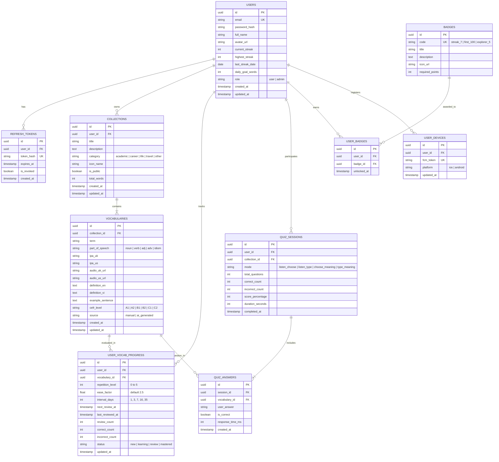

# TÀI LIỆU ĐẶC TẢ KỸ THUẬT VÀ PHÂN CHIA TÁC VỤ BACKEND (BE SPECIFICATION)
## DỰ ÁN: KARVOCAB — LEARN SMART, REMEMBER LONGER

---

## MỤC LỤC
1. [TỔNG QUAN KIẾN TRÚC BACKEND & TECH STACK](#1-tổng-quan-kiến-trúc-backend--tech-stack)
2. [THIẾT KẾ CƠ SỞ DỮ LIỆU (DATABASE SCHEMA & ERD)](#2-thiết-kế-cơ-sở-dữ-liệu-database-schema--erd)
3. [ĐẶC TẢ HỆ THỐNG API (RESTFUL API CONTRACTS)](#3-đặc-tả-hệ-thống-api-restful-api-contracts)
4. [QUY TẮC NGHIỆP VỤ BACKEND & BACKGROUND JOBS](#4-quy-tắc-nghiệp-vụ-backend--background-jobs)
5. [KẾ HOẠCH PHÂN CHIA TASK CHO BACKEND THEO PHASE](#5-kế-hoạch-phân-chia-task-cho-backend-theo-phase)
6. [TIÊU CHUẨN KỸ THUẬT, BẢO MẬT & TESTING CHO BE](#6-tiêu-chuẩn-kỹ-thuật-bảo-mật--testing-cho-be)

---

## 1. TỔNG QUAN KIẾN TRÚC BACKEND & TECH STACK

### 1.1. Đề xuất Tech Stack
Hệ thống Backend cần xử lý các tác vụ API CRUD thông thường, tác vụ nền tính toán thuật toán Spaced Repetition, tích hợp sinh từ AI (LLM) và sinh audio (TTS).

* **Ngôn ngữ & Framework:** **Node.js (NestJS / TypeScript)** hoặc **Go (Gin/Fiber)** hoặc **Python (FastAPI)**.
  *(Khuyến nghị: **NestJS (TypeScript)** vì kiến trúc module chuẩn doanh nghiệp, chia tầng rõ ràng, dùng chung DTO/Types với Frontend TypeScript).*
* **Cơ sở dữ liệu chính (RDBMS):** **PostgreSQL 15+** (Lưu trữ quan hệ người dùng, từ vựng, học phần, lịch sử phiên luyện tập).
* **Caching & Queue:** **Redis 7+** (Lưu session, token blacklist, rate-limiting, hàng đợi BullMQ xử lý tác vụ background).
* **Lưu trữ tệp (Object Storage):** **AWS S3** hoặc **Cloudflare R2** hoặc **Google Cloud Storage** (Lưu trữ avatar, file audio phát âm từ vựng MP3).
* **AI & Machine Learning Engine:**
  * **Google Gemini API** (`gemini-1.5-flash` hoặc `gemini-2.0-flash` qua Structured Outputs / JSON Schema) để tạo từ vựng theo chủ đề và chuẩn CEFR.
  * **Text-to-Speech (TTS):** Google Cloud Text-to-Speech hoặc AWS Polly hoặc Edge-TTS (sinh file phát âm chuẩn UK/US chuẩn xác).
* **Push Notification:** **Firebase Cloud Messaging (FCM)**.

### 1.2. Sơ đồ Kiến trúc Hệ thống (System Architecture)

```
[Mobile FE: iOS / Android]
          │
          ▼  HTTPS / REST / JSON
┌───────────────────────────────────────────────┐
│        API GATEWAY & REVERSE PROXY            │
│       (Nginx / Cloudflare Rate Limit)         │
└───────────────────────┬───────────────────────┘
                        │
┌───────────────────────▼───────────────────────┐
│              BACKEND API SERVICE              │
│   (NestJS Modular Server / JWT Auth Guard)    │
│  ┌─────────┬─────────┬─────────┬────────────┐ │
│  │  Auth   │  Vocab  │  Quiz   │ AI Engine  │ │
│  │ Module  │ Module  │ Module  │  Module    │ │
│  └─────────┴─────────┴─────────┴────────────┘ │
└───────────┬───────────────┬──────────────┬────┘
            │               │              │
    ┌───────▼──────┐ ┌──────▼──────┐ ┌─────▼───────┐
    │  PostgreSQL  │ │    Redis    │ │ Object      │
    │  Database    │ │ Cache/Queue │ │ Storage S3  │
    └──────────────┘ └──────┬──────┘ └─────────────┘
                            │
              ┌─────────────▼──────────────┐
              │     BACKGROUND WORKERS     │
              │  (Spaced Repetition Cron,  │
              │   FCM Reminder, TTS Job)   │
              └─────────────┬──────────────┘
                            │
                 ┌──────────┴──────────┐
                 ▼                     ▼
          [Google Gemini API]     [Google TTS]
```

---

## 2. THIẾT KẾ CƠ SỞ DỮ LIỆU (DATABASE SCHEMA & ERD)

Dưới đây là sơ đồ Quan hệ Thực thể (**Entity Relationship Diagram**) thể hiện toàn bộ cấu trúc bảng, khoá chính (PK), khoá ngoại (FK) và mối quan hệ dữ liệu:



---

## 3. ĐẶC TẢ HỆ THỐNG API (RESTFUL API CONTRACTS)

### 3.1. Nhóm Xác thực (Authentication)
* **`POST /api/v1/auth/register`**
  * *Request Body:* `{ "email": "user@example.com", "password": "Password123", "fullName": "Nguyen Van A" }`
  * *Response 201:* `{ "accessToken": "...", "refreshToken": "...", "user": { "id": "...", "email": "..." } }`
  * *Validation:* Email RFC 5322, Password tối thiểu 8 ký tự (chữ hoa + số), hash bằng `bcrypt` (salt rounds = 10 hoặc 12).
* **`POST /api/v1/auth/login`**
  * *Request Body:* `{ "email": "user@example.com", "password": "Password123" }`
  * *Response 200:* `{ "accessToken": "...", "refreshToken": "...", "user": { ... } }`
* **`POST /api/v1/auth/social-login`**
  * *Request Body:* `{ "provider": "google | facebook", "idToken": "..." }`
  * *Xử lý:* Verify ID token với Google/Facebook API $\rightarrow$ find or create user $\rightarrow$ trả JWT token.
* **`POST /api/v1/auth/refresh`**
  * *Request Body:* `{ "refreshToken": "..." }`
  * *Xử lý:* Verify refresh token trong DB, kiểm tra `is_revoked`, cấp lại cặp token mới (Token Rotation).
* **`POST /api/v1/auth/forgot-password`**
  * *Request Body:* `{ "email": "..." }`
  * *Xử lý:* Sinh mã OTP 6 số lưu vào Redis với TTL = 300s, gửi email qua SES / SendGrid / Resend.
* **`POST /api/v1/auth/reset-password`**
  * *Request Body:* `{ "email": "...", "otp": "123456", "newPassword": "..." }`

---

### 3.2. Nhóm Trang chủ & Thống kê (Dashboard & Profile)
* **`GET /api/v1/home/dashboard`**
  * *Headers:* `Authorization: Bearer <accessToken>`
  * *Response 200:*
    ```json
    {
      "streak": {
        "currentStreak": 5,
        "highestStreak": 12,
        "isStreakActiveToday": true
      },
      "dailyGoal": {
        "targetWords": 10,
        "wordsLearnedToday": 7,
        "progressPercentage": 70
      },
      "reviewReminder": {
        "hasPendingReview": true,
        "dueWordsCount": 8
      },
      "quickCollections": [ ... ]
    }
    ```
* **`GET /api/v1/users/profile`**
  * *Response 200:* Profile cá nhân, thống kê tổng số từ đã thành thạo (`mastered`), danh sách huy hiệu kèm trạng thái `unlocked`.
* **`PATCH /api/v1/users/settings`**
  * *Request Body:* `{ "dailyGoalWords": 15, "reminderTime": "20:00", "isNotificationEnabled": true }`

---

### 3.3. Nhóm Quản lý Học phần & Từ vựng (Collections & Vocabularies)
* **`GET /api/v1/collections`**
  * *Query Params:* `?category=academic&search=ielts&page=1&limit=20`
  * *Response 200:* Danh sách bộ sưu tập của user kèm số lượng từ vựng hiện có.
* **`POST /api/v1/collections`**
  * *Request Body:* `{ "title": "IELTS Academic Core", "description": "Bộ từ vựng band 7+", "category": "academic", "iconName": "book" }`
* **`GET /api/v1/collections/:id/words`**
  * *Response 200:* Danh sách từ vựng trong bộ sưu tập, bao gồm IPA, audio URL, cấp độ CEFR và trạng thái Spaced Repetition của người dùng với từ đó.
* **`POST /api/v1/collections/:id/words`**
  * *Request Body:*
    ```json
    {
      "term": "coherent",
      "partOfSpeech": "adj",
      "definitionVi": "mạch lạc, chặt chẽ",
      "definitionEn": "logical and consistent",
      "exampleSentence": "He proposed a coherent plan for reform.",
      "cefrLevel": "B2"
    }
    ```
  * *Xử lý ngầm (Background Event):* Sau khi lưu vào DB, đẩy job vào Redis queue để tự động sinh file phát âm (TTS) và upload lên S3 nếu chưa có audio.
* **`PUT /api/v1/vocabularies/:id`** $\rightarrow$ Sửa thông tin từ vựng.
* **`DELETE /api/v1/vocabularies/:id`** $\rightarrow$ Xoá từ vựng (đồng thời xoá progress liên quan).

---

### 3.4. Nhóm Sinh từ vựng bằng AI (AI Vocab Generator)
* **`POST /api/v1/ai/generate-vocab`**
  * *Rate Limit:* Tối đa 5 request / phút / user để tránh lạm dụng token LLM.
  * *Request Body:*
    ```json
    {
      "topic": "Sustainable Energy & Green Tech",
      "cefrLevel": "B2",
      "wordCount": 5
    }
    ```
  * *Prompt Engineering & Xử lý BE:*
    * Gọi Google Gemini API với Schema Response JSON bắt buộc:
      ```json
      {
        "type": "object",
        "properties": {
          "words": {
            "type": "array",
            "items": {
              "type": "object",
              "properties": {
                "term": { "type": "string" },
                "partOfSpeech": { "type": "string" },
                "ipa": { "type": "string" },
                "definitionEn": { "type": "string" },
                "definitionVi": { "type": "string" },
                "exampleSentence": { "type": "string" },
                "cefrLevel": { "type": "string" }
              },
              "required": ["term", "partOfSpeech", "definitionEn", "definitionVi", "exampleSentence", "cefrLevel"]
            }
          }
        }
      }
      ```
  * *Response 200:* Mảng danh sách từ vựng có cấu trúc để FE hiển thị màn xem trước (`Màn 14`).
* **`POST /api/v1/vocabularies/batch-save`**
  * *Request Body:* `{ "collectionId": "uuid", "words": [ { ... }, { ... } ] }`
  * *Xử lý:* Thực hiện trong 1 Database Transaction duy nhất, khởi tạo đồng thời bản ghi trong `USER_VOCAB_PROGRESS` cho từng từ với `status: 'new'`.

---

### 3.5. Nhóm Luyện tập & Thuật toán Spaced Repetition (Quiz & Progress)
* **`GET /api/v1/practice/questions`**
  * *Query Params:* `?collectionId=uuid&mode=listen_choose&limit=10`
  * *Xử lý BE:*
    * Chọn ngẫu nhiên các từ ưu tiên trong hàng đợi ôn tập (`due_for_review`).
    * Nếu mode là trắc nghiệm 4 đáp án: BE tự động bốc thêm 3 từ khác làm phương án gây nhiễu (distractors) cùng từ loại để tạo 4 lựa chọn A, B, C, D ngẫu nhiên.
* **`POST /api/v1/practice/submit-session`**
  * *Request Body:*
    ```json
    {
      "collectionId": "uuid",
      "mode": "listen_choose",
      "durationSeconds": 145,
      "answers": [
        { "vocabularyId": "uuid-1", "userAnswer": "coherent", "isCorrect": true, "responseTimeMs": 2300 },
        { "vocabularyId": "uuid-2", "userAnswer": "wrong", "isCorrect": false, "responseTimeMs": 4100 }
      ]
    }
    ```
  * *Xử lý Nghiệp vụ BE:*
    1. Lưu bản ghi `QUIZ_SESSIONS` và danh sách `QUIZ_ANSWERS`.
    2. Cập nhật thuật toán Spaced Repetition cho từng từ (chi tiết mục 4.1).
    3. Kiểm tra và cập nhật `Streak` hằng ngày của User.
    4. Kiểm tra điều kiện mở khoá Huy hiệu (Badges) mới.
    5. *Response 200:* Tổng kết điểm số, streak mới cập nhật, huy hiệu mới đạt được (nếu có).

---

## 4. QUY TẮC NGHIỆP VỤ BACKEND & BACKGROUND JOBS

### 4.1. Thuật toán Lặp lại Ngắt quãng (Spaced Repetition Algorithm — SM-2 Biến thể)
Mỗi khi người dùng hoàn thành 1 câu hỏi đối với từ vựng, BE thực hiện cập nhật bản ghi `USER_VOCAB_PROGRESS`:

1. **Nếu trả lời ĐÚNG (`isCorrect == true`):**
   * Tăng cấp độ lặp lại: `repetition_level = repetition_level + 1`.
   * Tính khoảng cách ngày ôn tập tiếp theo (`interval_days`):
     * Level 1: `1 ngày`
     * Level 2: `3 ngày`
     * Level 3: `7 ngày`
     * Level 4: `16 ngày`
     * Level 5: `35 ngày` $\rightarrow$ Đánh dấu `status = 'mastered'`.
   * Cập nhật thời điểm ôn tiếp theo: `next_review_at = NOW() + interval_days`.
   * Hệ số dễ dàng: `ease_factor = ease_factor + 0.1` (tối đa 2.5).

2. **Nếu trả lời SAI (`isCorrect == false`):**
   * Reset cấp độ: `repetition_level = 0`.
   * Đặt lại khoảng cách: `interval_days = 1` (phải ôn lại vào ngày mai).
   * Giảm hệ số dễ dàng: `ease_factor = max(1.3, ease_factor - 0.2)`.
   * Đánh dấu `status = 'learning'`.

---

### 4.2. Hệ thống Cron Jobs Định kỳ (Background Scheduled Tasks)

| Tên Job | Thời gian chạy | Nhiệm vụ chính |
| :--- | :--- | :--- |
| **`Streak-Evaluation-Job`** | Mỗi giờ một lần (theo múi giờ user) | Kiểm tra xem người dùng đã học trong ngày chưa. Nếu qua 23:59 local time mà không học $\rightarrow$ Reset `current_streak = 0`. |
| **`Daily-Review-Notification-Job`** | Chạy mỗi 15 phút | Quét bảng `USER_VOCAB_PROGRESS` tìm các từ có `next_review_at <= NOW()` và gửi Push Notification (FCM) vào khung giờ nhắc học mà user đã cài đặt (vd: 20:00). |
| **`Audio-TTS-Worker`** | Trigger theo Queue sự kiện | Nhận job khi có từ vựng mới được thêm $\rightarrow$ gọi TTS API tạo file MP3 UK & US $\rightarrow$ đẩy lên S3 $\rightarrow$ cập nhật `audio_uk_url` vào DB. |

---

## 5. KẾ HOẠCH PHÂN CHIA TASK CHO 2 BACKEND DEVELOPERS (PARALLEL NON-BLOCKING BREAKDOWN)

> **Mô hình làm việc:** Phân chia theo **2 Nhánh dịch vụ độc lập (Track BE-1 & Track BE-2)** cho 2 kỹ sư Backend làm việc song song trong 4 Sprint (8 tuần).
> **Mục tiêu cốt lõi:** Phân lập rõ ràng theo Domain-Driven Design (DDD) trong NestJS, **tuyệt đối không bị nghẽn (blocking)**, không sửa đè file schema/controller của nhau, phát triển độc lập và tích hợp qua Service Interfaces.

```
┌─────────────────────────────────────────────────────────────────────────────────────────────┐
│                           CHIẾN LƯỢC PHÂN CHIA WORKLOAD CHO 2 BE DEVELOPERS                 │
├──────────────────────────────────────────────┬──────────────────────────────────────────────┤
│ 👤 DEVELOPER BE-1 (TRACK A): CORE & CONTENT  │ 👤 DEVELOPER BE-2 (TRACK B): AI & QUIZ ENGINE│
│ - Hạ tầng Docker, DB Migration & Base Setup  │ - Tích hợp AI LLM (Google Gemini API)        │
│ - Module Auth, Session, OAuth & Security     │ - Module Sinh từ vựng AI & Batch Save        │
│ - Module Học phần (Collections) CRUD         │ - Lõi Quiz Engine Controller & Distractors   │
│ - Module Từ vựng (Vocabularies) CRUD         │ - Thuật toán Chấm điểm & Fuzzy Matching      │
│ - Object Storage S3 & Worker sinh Audio TTS  │ - Thuật toán Spaced Repetition (SM-2 Engine) │
│ - User Profile, Settings & FCM Push Service  │ - Dashboard Trang chủ (Streak, Daily Goal)   │
│ - Offline Sync API, Security & CI/CD         │ - Cron Jobs (Streak Reset, Push Scheduler)   │
│ ➜ TỔNG KHỐI LƯỢNG: 101 SP (~50 ngày)         │ ➜ TỔNG KHỐI LƯỢNG: 101 SP (~50 ngày)         │
└──────────────────────────────────────────────┴──────────────────────────────────────────────┘
```

---

### 5.1. 4 Nguyên tắc để 2 Backend Developers KHÔNG BỊ BLOCK / XUNG ĐỘT

1. **Quy tắc Quản lý CSDL & Migration (Database Isolation):**
   * Trong 2 ngày đầu Sprint 1, cả 2 BE cùng thống nhất và chốt file `schema.prisma` (hoặc TypeORM entities) ban đầu có đủ 9 bảng như mục 2 ERD.
   * **BE-1** chạy migration khởi tạo đầu tiên `init` và push lên nhánh `main`.
   * Các sprint tiếp theo, mỗi BE chỉ mở rộng các bảng thuộc domain của mình. Mọi thay đổi schema bắt buộc tạo migration file mới riêng biệt, **không sửa đè migration cũ**.
2. **Phân lập Thư mục Module trong NestJS:**
   * **BE-1 sở hữu:** `src/modules/auth/`, `src/modules/collections/`, `src/modules/vocabularies/`, `src/modules/storage/`, `src/modules/audio/`, `src/modules/users/`, `src/modules/notifications/`.
   * **BE-2 sở hữu:** `src/modules/ai/`, `src/modules/quiz/`, `src/modules/spaced-repetition/`, `src/modules/dashboard/`, `src/modules/gamification/`, `src/jobs/`.
   * *Không sửa chéo Controller, Service hay DTO của nhau.*
3. **Môi trường Phát triển Cục bộ Độc lập (Local Docker Compose):**
   * Cả 2 dev đều khởi chạy `docker-compose.yml` trên máy local của mình (Postgres 15, Redis 7). Không dùng chung một database staging từ xa trong quá trình code tính năng để tránh đè dữ liệu test.
4. **Giao tiếp liên Module qua Service Interface (Dependency Injection):**
   * *Ví dụ:* Khi BE-2 làm tính năng lưu hàng loạt từ AI vào Collection, BE-2 chỉ cần gọi hàm interface `vocabulariesService.createBatch(words)` do BE-1 khai báo. Trong thời gian BE-1 đang code, BE-2 có thể mock kết quả trả về của hàm này để hoàn thiện logic của mình mà không bị dừng lại chờ đợi.

---

### 5.2. Lộ trình Phân công Chi tiết qua 4 Sprint (8 Tuần) cho 2 BE Dev

#### 🏁 SPRINT 1 (Tuần 1 – 2): Hạ tầng, Auth vs. AI Vocab Generator Module

| Phụ trách | Task ID | Module | Tên Task & Yêu cầu nghiệm thu chi tiết | Est (SP) |
| :--- | :--- | :--- | :--- | :---: |
| **BE 1** | **BE1-S1-01** | Infra | **Boilerplate & Docker Compose:** Setup NestJS, Prisma/TypeORM, Dockerfile, docker-compose (PostgreSQL 15, Redis 7, pgAdmin). | 3 |
| **BE 1** | **BE1-S1-02** | Database | **Khởi tạo Schema & Migration `init`:** Định nghĩa 9 bảng theo ERD, thiết lập Foreign Keys, Constraints, chạy migration đầu tiên. | 4 |
| **BE 1** | **BE1-S1-03** | Auth | **API Đăng ký (`POST /auth/register`):** Validate email regex, hash mật khẩu bcrypt (salt 10), trả về Access Token (15p) + Refresh Token (7d). | 4 |
| **BE 1** | **BE1-S1-04** | Auth | **API Đăng nhập (`POST /auth/login`):** Xác thực email/password, lưu hash refresh token vào DB. | 3 |
| **BE 1** | **BE1-S1-05** | Auth | **API Social Login Google & Facebook:** Xác thực OAuth ID token từ SDK, map thông tin user, tự tạo tài khoản nếu lần đầu. | 5 |
| **BE 1** | **BE1-S1-06** | Auth | **API Refresh Token & Logout:** Cấp lại cặp token mới (Token Rotation), đưa access token cũ vào Redis Blacklist khi logout. | 3 |
| **BE 1** | **BE1-S1-07** | Auth | **API Quên mật khẩu & Gửi OTP:** Sinh OTP 6 số lưu Redis với TTL = 300s, tích hợp template mail gửi mã xác nhận. | 4 |
| **BE 1** | **BE1-S1-08** | Core | **JWT Auth Guard, Swagger UI & Global Filter:** Middleware bảo vệ route, xuất bản Swagger tại `/api/docs`, bắt lỗi Exception chuẩn JSON. | 2 |
| *Tiểu kết BE 1*| | | *Hoàn thiện hạ tầng cốt lõi, CSDL và trọn bộ API Xác thực.* | **28 SP** |
| | | | | |
| **BE 2** | **BE2-S1-01** | AI Engine | **Tích hợp Google Gemini API SDK:** Cấu hình Client Gemini, quản lý API key bảo mật trong biến môi trường. | 4 |
| **BE 2** | **BE2-S1-02** | AI Engine | **Prompt Engineering với Structured Output:** Thiết lập JSON Schema nghiêm ngặt ép kiểu AI trả về đúng cấu trúc từ vựng, nghĩa, IPA, ví dụ theo CEFR. | 6 |
| **BE 2** | **BE2-S1-03** | AI Engine | **API Sinh từ vựng AI (`POST /ai/generate-vocab`):** Nhận topic, cefrLevel (A1-C1), wordCount (3-20), gọi Gemini và trả về danh sách từ xem trước. | 5 |
| **BE 2** | **BE2-S1-04** | AI Engine | **Rate Limiting & Timeout Fallback:** Giới hạn 5 req/phút/user qua Redis, xử lý timeout >15s với thông báo lỗi thân thiện. | 4 |
| **BE 2** | **BE2-S1-05** | Vocab | **API Lưu hàng loạt từ vựng AI (`batch-save`):** Nhận mảng từ được chọn, chạy DB Transaction insert đồng loạt vào bảng `VOCABULARIES`. | 5 |
| **BE 2** | **BE2-S1-06** | Test | **Unit Test cho AI Engine:** Giả lập Mock responses của Gemini để test toàn bộ các trường hợp thành công, lỗi JSON, timeout. | 3 |
| *Tiểu kết BE 2*| | | *Hoàn thành module sinh từ thông minh bằng AI sẵn sàng cho FE test.* | **27 SP** |

---

#### 📦 SPRINT 2 (Tuần 3 – 4): Quản lý Học phần & Audio TTS vs. Quiz Engine & Chấm điểm

| Phụ trách | Task ID | Module | Tên Task & Yêu cầu nghiệm thu chi tiết | Est (SP) |
| :--- | :--- | :--- | :--- | :---: |
| **BE 1** | **BE1-S2-01** | Collection | **API Quản lý Học phần (`GET`, `POST /collections`):** Hỗ trợ phân trang, tìm kiếm từ khoá, lọc theo category, tính tổng số từ trong học phần. | 5 |
| **BE 1** | **BE1-S2-02** | Vocab | **API Danh sách từ theo Học phần (`GET /collections/:id/words`):** Trả danh sách từ vựng kèm phát âm IPA, nghĩa song ngữ, audio URL. | 4 |
| **BE 1** | **BE1-S2-03** | Vocab | **API Thêm, Sửa, Xoá từ vựng (`POST`, `PUT`, `DELETE /vocabularies/:id`):** CRUD từ vựng đầy đủ validation, xoá an toàn kèm progress. | 5 |
| **BE 1** | **BE1-S2-04** | Storage | **Module Object Storage (S3 / Cloudflare R2):** Service upload tệp, cấu hình CDN Public Read URL cho audio mp3 và avatar. | 4 |
| **BE 1** | **BE1-S2-05** | Audio | **Worker Tự động tạo Audio TTS:** Lắng nghe job Redis khi thêm từ mới $\rightarrow$ gọi Google TTS tạo file MP3 giọng UK/US $\rightarrow$ upload S3 $\rightarrow$ cập nhật DB. | 7 |
| **BE 1** | **BE1-S2-06** | Audio | **Batch Audio Worker cho từ vựng AI:** Xử lý hàng đợi sinh 10-20 file âm thanh dưới nền không gây nghẽn luồng API chính. | 4 |
| *Tiểu kết BE 1*| | | *Hoàn thiện toàn bộ CRUD Học phần & Hạ tầng phát âm TTS tự động.* | **29 SP** |
| | | | | |
| **BE 2** | **BE2-S2-01** | Quiz | **Thiết kế Lõi Quiz Engine Controller:** Quản lý state phiên làm bài, cấu trúc câu hỏi cho 4 chế độ luyện tập. | 6 |
| **BE 2** | **BE2-S2-02** | Quiz | **API Lấy câu hỏi luyện tập (`GET /practice/questions`):** Query danh sách từ cần học, thuật toán tự động bốc ngẫu nhiên 3 distractors gây nhiễu cho trắc nghiệm. | 6 |
| **BE 2** | **BE2-S2-03** | Quiz | **API Nộp kết quả phiên học (`POST /practice/submit-session`):** Nhận mảng câu trả lời, tính điểm số %, lưu bản ghi `QUIZ_SESSIONS` & `QUIZ_ANSWERS`. | 6 |
| **BE 2** | **BE2-S2-04** | Quiz | **Logic Chấm điểm gõ từ & Fuzzy Matching:** Chuẩn hóa chuỗi (trim, lowercase), so khớp khoảng cách Levenshtein $\le 1$ để phát hiện lỗi gõ suýt đúng. | 4 |
| **BE 2** | **BE2-S2-05** | Quiz | **API Luyện lại các câu sai (`GET /practice/retry-missed`):** Lọc danh sách `vocabularyId` bị sai trong session vừa hoàn thành để tạo quiz phụ. | 3 |
| **BE 2** | **BE2-S2-06** | Test | **Unit Test & Stress Test Quiz Engine:** Đảm bảo thuật toán bốc distractors nhanh $<50ms$ cho danh sách hàng nghìn từ. | 3 |
| *Tiểu kết BE 2*| | | *Hoàn thành trọn vẹn bộ API Luyện tập 4 Chế độ & Chấm điểm trắc nghiệm.* | **28 SP** |

---

#### ⚡ SPRINT 3 (Tuần 5 – 6): Users & Push Notification vs. Spaced Repetition SM-2 & Dashboard

| Phụ trách | Task ID | Module | Tên Task & Yêu cầu nghiệm thu chi tiết | Est (SP) |
| :--- | :--- | :--- | :--- | :---: |
| **BE 1** | **BE1-S3-01** | Profile | **API Hồ sơ cá nhân (`GET /users/profile`):** Thống kê tổng số từ đã học, số ngày streak, danh sách huy hiệu đã mở khoá. | 4 |
| **BE 1** | **BE1-S3-02** | Profile | **API Cài đặt tài khoản (`PATCH /users/settings`):** Cập nhật mục tiêu số từ/ngày (`dailyGoalWords`), giờ nhắc học (`reminderTime`), đổi mật khẩu. | 4 |
| **BE 1** | **BE1-S3-03** | Device | **API Đăng ký thiết bị (`POST /users/devices`):** Lưu trữ FCM token của người dùng kèm platform (iOS/Android) vào bảng `USER_DEVICES`. | 3 |
| **BE 1** | **BE1-S3-04** | Push Notif | **Tích hợp Firebase Cloud Messaging (FCM Admin SDK):** Cấu hình Service Account, xây dựng module bắn Push Notification nền tảng. | 5 |
| **BE 1** | **BE1-S3-05** | Push Notif | **Service Gửi Thông báo đa thiết bị:** Hàm `sendPushNotification(userId, title, body, data)` hỗ trợ gửi đa thiết bị, tự dọn token chết. | 4 |
| **BE 1** | **BE1-S3-06** | Docs | **Cập nhật Swagger & Hỗ trợ FE 1 tích hợp:** Cung cấp tài liệu API chuẩn và test phối hợp với Frontend Dev 1. | 6 |
| *Tiểu kết BE 1*| | | *Hoàn thành Profile, Settings, Hạ tầng FCM Push Notification.* | **26 SP** |
| | | | | |
| **BE 2** | **BE2-S3-01** | Spaced Rep | **Xây dựng Engine Thuật toán SM-2 Spaced Repetition:** Tính toán chính xác `next_review_at`, `interval_days` (1, 3, 7, 16, 35 ngày), `ease_factor`. | 7 |
| **BE 2** | **BE2-S3-02** | Spaced Rep | **Tích hợp Cập nhật Tiến độ sau bài học:** Tự động gọi engine SM-2 cập nhật bảng `USER_VOCAB_PROGRESS` ngay khi submit session. | 4 |
| **BE 2** | **BE2-S3-03** | Spaced Rep | **API Hàng đợi ôn tập hôm nay (`GET /practice/due`):** Query tối ưu danh sách từ có `next_review_at <= NOW()`, ưu tiên từ cần ôn gấp. | 5 |
| **BE 2** | **BE2-S3-04** | Dashboard | **API Tổng quan Trang chủ (`GET /home/dashboard`):** Tổng hợp dữ liệu Streak, thanh tiến độ Daily Goal trong ngày, số từ cần ôn tập. | 6 |
| **BE 2** | **BE2-S3-05** | Docs | **Cập nhật Swagger & Hỗ trợ FE 2 tích hợp:** Cung cấp tài liệu API AI/Quiz/Dashboard và test phối hợp với Frontend Dev 2. | 6 |
| *Tiểu kết BE 2*| | | *Hoàn thiện thuật toán Spaced Repetition & API Dashboard Trang chủ.* | **28 SP** |

---

#### 🎯 SPRINT 4 (Tuần 7 – 8): Offline Sync & Hardening vs. Cron Jobs & Gamification

| Phụ trách | Task ID | Module | Tên Task & Yêu cầu nghiệm thu chi tiết | Est (SP) |
| :--- | :--- | :--- | :--- | :---: |
| **BE 1** | **BE1-S4-01** | Sync | **API Đồng bộ Dữ liệu Offline (`GET /sync/delta`):** Trả về danh sách từ/học phần đã thay đổi kể từ `last_synced_at` để FE đồng bộ SQLite. | 6 |
| **BE 1** | **BE1-S4-02** | Database | **Database Indexing & Query Tuning:** Đánh composite index cho các câu query nặng (`user_id`, `next_review_at`, `category`), tối ưu Explain Analyze. | 4 |
| **BE 1** | **BE1-S4-03** | Security | **Bảo mật & Rate-limiting Nâng cao:** Cấu hình Helmet, CORS, Data Sanitization, chặn Brute-force mật khẩu bằng Redis. | 4 |
| **BE 1** | **BE1-S4-04** | DevOps | **CI/CD Pipeline & Backup Tự động:** Setup GitHub Actions build Docker image, chạy test tự động, cron script backup CSDL lên S3 mỗi ngày. | 4 |
| *Tiểu kết BE 1*| | | *Hoàn thành Offline Sync API, Tối ưu CSDL, Bảo mật & CI/CD.* | **18 SP** |
| | | | | |
| **BE 2** | **BE2-S4-01** | Cron | **Cron Job Đánh giá & Reset Streak lúc nửa đêm:** Quét người dùng qua 23:59 (theo múi giờ local) chưa hoàn thành bài học để reset Streak = 0. | 5 |
| **BE 2** | **BE2-S4-02** | Cron | **Cron Job Nhắc nhở Ôn tập hằng ngày:** Quét từ đến hạn ôn tập và gọi Service FCM của BE-1 để bắn push notification đúng giờ hẹn của user. | 4 |
| **BE 2** | **BE2-S4-03** | Gamify | **Hệ thống Vinh danh & Huy hiệu (Badges Engine):** Tự động kiểm tra điều kiện đạt huy hiệu (`streak_7`, `first_100`, `explorer_5`) sau mỗi bài học. | 5 |
| **BE 2** | **BE2-S4-04** | QA | **Performance & Load Testing:** Dùng k6 test tải 500 CCU đồng thời vào API Submit Quiz và Sinh từ AI, đảm bảo P95 $<300ms$. | 4 |
| *Tiểu kết BE 2*| | | *Hoàn thành toàn bộ Cron Jobs nền tảng, Hệ thống Huy hiệu & Test tải.* | **18 SP** |
| | | | | |
| **CẢ 2 BE** | **SHARED-BE-01** | Toàn hệ thống | **End-to-End API Integration Testing:** Phối hợp cùng 2 FE Dev kiểm thử toàn bộ luồng Auth $\rightarrow$ AI $\rightarrow$ Quiz $\rightarrow$ Spaced Repetition $\rightarrow$ Streak. | 6 |
| **CẢ 2 BE** | **SHARED-BE-02** | Production | **Deploy Staging / Production & Monitoring:** Cấu hình domain HTTPS, SSL, giám sát Log & Alerting với Sentry / Grafana. | 4 |
| *Tiểu kết Chung*| | | *Bàn giao toàn bộ hệ sinh thái Backend sẵn sàng đưa vào vận hành.* | **10 SP** |

---

### 5.3. Bảng Cân đối Tải công việc Backend (Story Points Balance)

| Giai đoạn | Developer BE-1 (Core & Content) | Developer BE-2 (AI & Quiz Engine) | Phối hợp chung | Tổng SP Sprint |
| :--- | :---: | :---: | :---: | :---: |
| **Sprint 1 (Tuần 1 - 2)** | 28 SP | 27 SP | — | **55 SP** |
| **Sprint 2 (Tuần 3 - 4)** | 29 SP | 28 SP | — | **57 SP** |
| **Sprint 3 (Tuần 5 - 6)** | 26 SP | 28 SP | — | **54 SP** |
| **Sprint 4 (Tuần 7 - 8)** | 18 SP | 18 SP | 10 SP | **46 SP** |
| **TỔNG CỘNG** | **101 SP** | **101 SP** | **10 SP** | **212 SP** |

> *Ghi chú:* Mỗi Backend Developer đảm nhận trung bình **12 - 14 SP / tuần** ($\approx$ 6 - 7 ngày làm việc tiêu chuẩn), đảm bảo nhịp độ phát triển đồng tốc với 2 Frontend Developers và cung cấp kịp thời API cho cả 2 nhánh phát triển.

---

## 6. TIÊU CHUẨN KỸ THUẬT, BẢO MẬT & TESTING CHO BE DEV

1. **Chuẩn hóa API Response:** Mọi API phản hồi đều phải tuân theo cấu trúc JSON chuẩn:
   ```json
   {
     "success": true,
     "data": { ... },
     "message": "Thành công",
     "timestamp": "2026-11-17T20:00:00Z"
   }
   ```
2. **Database Indexing:** Bắt buộc đánh Index trên các cột tìm kiếm thường xuyên:
   * `USERS(email)`
   * `COLLECTIONS(user_id, category)`
   * `VOCABULARIES(collection_id, term)`
   * `USER_VOCAB_PROGRESS(user_id, next_review_at, status)`
3. **Bảo mật dữ liệu:**
   * Mật khẩu không bao giờ được lưu dạng plaintext, bắt buộc hash bằng `bcrypt` hoặc `argon2`.
   * Cấu hình Rate Limiting bằng Redis để chống brute-force vào các endpoint nhạy cảm (`/auth/login`, `/auth/forgot-password`, `/ai/generate-vocab`).
4. **Testing & Code Quality:**
   * Viết Unit Test cho các logic nghiệp vụ lõi: Thuật toán Spaced Repetition (SM-2), Logic cộng/reset Streak.
   * Viết E2E Integration Test cho toàn bộ luồng Auth và luồng nộp bài Quiz.
