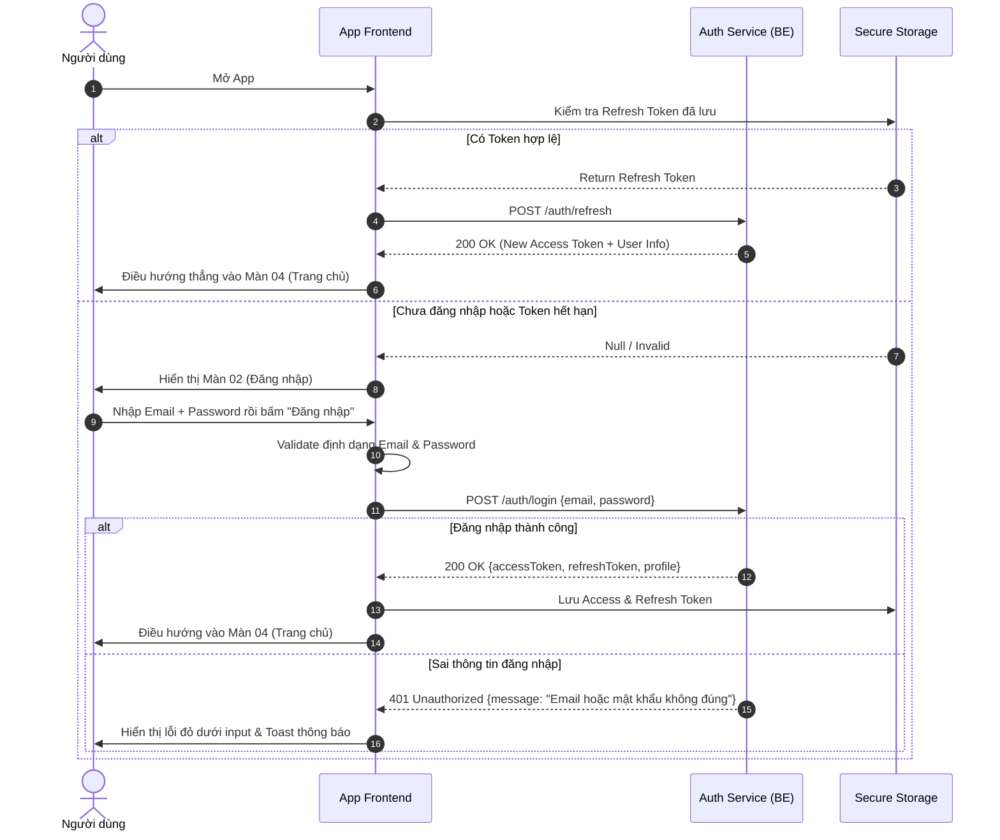
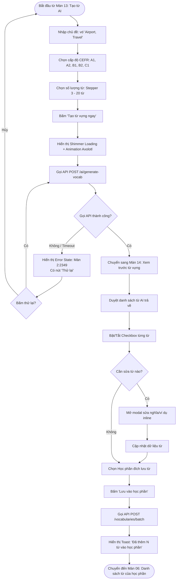
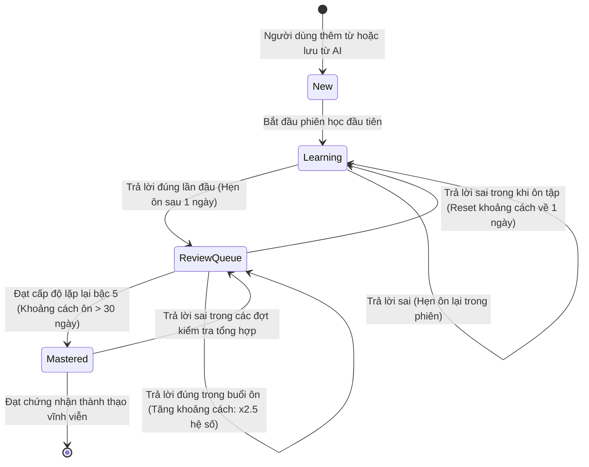
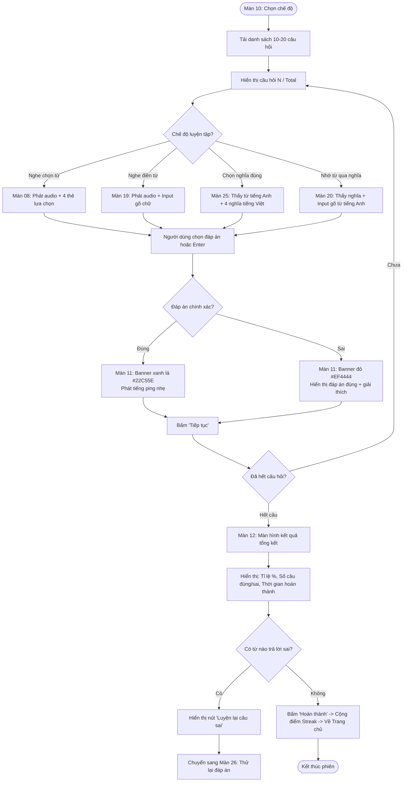

# TÀI LIỆU YÊU CẦU KỸ THUẬT VÀ PHÂN CHIA TÁC VỤ FRONTEND (FE SPECIFICATION)
## DỰ ÁN: KARVOCAB — LEARN SMART, REMEMBER LONGER

---

## MỤC LỤC
1. [TỔNG QUAN ỨNG DỤNG & DESIGN SYSTEM FOUNDATION](#1-tổng-quan-ứng-dụng--design-system-foundation)
2. [DANH SÁCH TÍNH NĂNG (FUNCTION LIST)](#2-danh-sách-tính-năng-function-list)
3. [SƠ ĐỒ LUỒNG TÍNH NĂNG CHÍNH (FEATURE USER FLOWS)](#3-sơ-đồ-luồng-tính-năng-chính-feature-user-flows)
4. [QUY TẮC NGHIỆP VỤ & VALIDATION RULES TỪNG MÀN HÌNH](#4-quy-tắc-nghiệp-vụ--validation-rules-từng-màn-hình)
5. [KẾ HOẠCH PHÂN CHIA TASK THEO PHASE (FE TASK BREAKDOWN)](#5-kế-hoạch-phân-chia-task-theo-phase-fe-task-breakdown)

---

## 1. TỔNG QUAN ỨNG DỤNG & DESIGN SYSTEM FOUNDATION

### 1.1. Giới thiệu sản phẩm
* **Tên ứng dụng:** KarVocab
* **Định vị:** Ứng dụng học và ghi nhớ từ vựng tiếng Anh theo phương pháp Spaced Repetition (Lặp lại ngắt quãng), tích hợp tạo từ vựng thông minh bằng AI.
* **Mascot đại diện:** Axolotl (Kỳ giông nước) — biểu tượng của sự kiên trì, tái tạo và tiến bộ mỗi ngày.
* **Đối tượng người dùng:** Học sinh, sinh viên, người đi làm ôn thi IELTS, TOEIC, Giao tiếp hoặc nâng cao vốn từ theo chứng chỉ chuẩn CEFR (A1 – C1).

### 1.2. Design System Tokens (Trích xuất từ Figma)

#### A. Bảng màu (Color Palette)
| Token Name | Mã Hex | Vai trò sử dụng |
| :--- | :--- | :--- |
| `color-primary-blue` | `#0095E8` | Màu thương hiệu chính, nút CTA, thanh tiến độ, icon active |
| `color-navy-blue` | `#0054AC` | Màu nhấn cao cấp, header, trạng thái hover/pressed của nút |
| `color-light-blue` | `#4FC3FF` | Màu viền focus, highlight, tag phụ |
| `color-soft-blue-surface` | `#DDF2FF` | Nền chip được chọn, background badge nổi bật |
| `color-main-bg` | `#F5FAFE` | Màu nền chính toàn app (light blue-tinted) |
| `color-secondary-bg` | `#EAF6FD` | Màu nền khu vực phân nhóm, container phụ |
| `color-card-bg` | `#FFFFFF` | Nền thẻ bài học, dialog, bottom sheet, modal |
| `color-text-primary` | `#17324D` | Tiêu đề chính, từ vựng, text quan trọng (Dark Navy) |
| `color-text-secondary` | `#64748B` | Mô tả phụ, nghĩa từ, nhãn trường nhập liệu |
| `color-text-muted` | `#94A3B8` | Placeholder, ngày tháng, thông tin mờ |
| `color-success-green` | `#22C55E` | Trả lời đúng, hoàn thành mục tiêu, streak tăng |
| `color-error-red` | `#EF4444` | Trả lời sai, báo lỗi form, nút xoá nguy hiểm |
| `color-warning-orange` | `#F59E0B` | Nhắc nhở sắp mất streak, từ cần ôn gấp |
| `color-info-blue` | `#0EA5E9` | Thông tin hướng dẫn, trợ giúp |

#### B. Typography (Phông chữ chủ đạo: Nunito)
* **Display (30px / Line-height 38px / ExtraBold 800):** Tên màn hình chào đón, tiêu đề lớn splash.
* **Heading (23px / Line-height 30px / ExtraBold 800):** Tiêu đề trang, tên học phần lớn.
* **Sub-heading (18px / Line-height 24px / Bold 700):** Tiêu đề thẻ, từ vựng chính trong câu hỏi.
* **Body Regular (15px / Line-height 22px / Regular 400):** Nội dung định nghĩa, ví dụ minh họa, giải thích.
* **Body Bold (15px / Line-height 22px / Bold 700):** Nhãn nút CTA, từ vựng trong danh sách.
* **Label / Caption (11px – 13px / SemiBold 600 & Bold 700):** CEFR Badges, tab bar label, timestamp.

#### C. Grid, Radius & Spacing Rules
* **Grid base:** 8px system (spacing: `8px`, `16px`, `24px`, `32px`).
* **Screen Margins:** Padding ngang chuẩn màn hình luôn là `24px` (hoặc `22px` theo bản Figma).
* **Touch Targets:** Tối thiểu từ `48px` đến `52px` cho tất cả Button, Input, Bottom Navigation tab.
* **Border Radius:**
  * Button / Input: `16px`
  * Card / Container: `20px` - `24px`
  * Badge / Chip: `100px` (Full Pill)

---

## 2. DANH SÁCH TÍNH NĂNG (FUNCTION LIST)

| Mã FR | Tên tính năng | Màn hình liên quan | Mô tả tóm tắt |
| :--- | :--- | :--- | :--- |
| **FR-AUTH-01** | Splash & Khởi động | `01 · Khởi động` | Hiển thị logo Axolotl, kiểm tra phiên đăng nhập tự động. |
| **FR-AUTH-02** | Đăng nhập tài khoản | `02 · Đăng nhập` | Đăng nhập qua Email/Password, Google OAuth, Facebook OAuth. |
| **FR-AUTH-03** | Đăng ký tài khoản | `03 · Đăng ký` | Đăng ký tài khoản mới, điều khoản sử dụng. |
| **FR-AUTH-04** | Quên mật khẩu | `21 · Quên mật khẩu` | Nhập email nhận OTP và đặt lại mật khẩu mới. |
| **FR-HOME-01** | Dashboard trang chủ | `04 · Trang chủ` | Thống kê Streak, thanh mục tiêu hằng ngày, nhắc nhở ôn tập, lối tắt bài học. |
| **FR-HOME-02** | Thông báo & Nhắc nhở | `04 · Trang chủ` | Modal/danh sách nhắc nhở ôn tập từ vựng đúng chu kỳ Spaced Repetition. |
| **FR-VOCAB-01**| Quản lý thư viện học phần | `05 · Thư viện học phần` | Danh sách bộ từ, tìm kiếm, lọc theo chủ đề (Học thuật, Du lịch, Công việc). |
| **FR-VOCAB-02**| Tạo học phần mới | `22 · Tạo học phần` | Tạo bộ sưu tập từ mới với tên, mô tả và chủ đề. |
| **FR-VOCAB-03**| Danh sách từ vựng hằng ngày | `06 · Từ vựng hằng ngày` | Xem danh sách từ trong học phần, phát âm thanh, huy hiệu CEFR. |
| **FR-VOCAB-04**| Chi tiết từ vựng | `07 · Chi tiết từ vựng` | Phát âm chuẩn UK/US, phiên âm IPA, định nghĩa, ví dụ, từ đồng nghĩa/trái nghĩa. |
| **FR-VOCAB-05**| Thêm từ thủ công | `24 · Thêm từ vựng` | Thêm từ đơn lẻ vào học phần kèm nghĩa và ví dụ. |
| **FR-VOCAB-06**| Chỉnh sửa từ vựng | `09 · Sửa từ vựng` | Sửa thông tin từ, phân loại từ loại (Noun, Verb, Adj). |
| **FR-VOCAB-07**| Xoá từ vựng | `28 · Xác nhận xóa từ` | Hộp thoại xác nhận xoá từ vựng khỏi học phần. |
| **FR-AI-01**   | Thiết lập sinh từ vựng AI | `13 · Tạo từ vựng bằng AI` | Nhập chủ đề, chọn cấp độ CEFR (A1-C1), chọn số lượng từ (stepper). |
| **FR-AI-02**   | Xem trước & Lưu từ vựng AI| `14 · Xem trước từ vựng AI`| Xem bảng kết quả do AI sinh ra, tick chọn/bỏ chọn, sửa inline, lưu vào học phần. |
| **FR-QUIZ-01** | Chọn chế độ luyện tập | `10 · Chọn chế độ luyện tập`| 4 chế độ: Nghe chọn từ, Nghe điền từ, Chọn nghĩa đúng, Nhớ từ qua nghĩa. |
| **FR-QUIZ-02** | Chế độ 1: Nghe chọn từ | `08 · Luyện nghe chọn từ` | Nghe audio phát âm, chọn 1 trong 4 đáp án đúng. |
| **FR-QUIZ-03** | Chế độ 2: Nghe và điền từ | `19 · Nghe và điền từ` | Nghe phát âm, gõ chính xác chính tả của từ vào ô nhập. |
| **FR-QUIZ-04** | Chế độ 3: Chọn nghĩa đúng | `25 · Chọn nghĩa đúng` | Hiển thị từ tiếng Anh, chọn nghĩa tiếng Việt chính xác. |
| **FR-QUIZ-05** | Chế độ 4: Nhớ từ qua nghĩa | `20 · Nhớ từ qua nghĩa` | Đọc định nghĩa/nghĩa tiếng Việt, gõ từ tiếng Anh tương ứng. |
| **FR-QUIZ-06** | Phản hồi kết quả câu hỏi | `11 · Phản hồi đáp án` | Hiển thị banner xanh/đỏ tức thì, giải thích chi tiết đáp án. |
| **FR-QUIZ-07** | Báo cáo kết quả buổi học | `12 · Kết quả luyện tập` | Điểm số, thời gian, số câu đúng/sai, danh sách từ làm sai. |
| **FR-QUIZ-08** | Luyện lại từ sai | `26 · Thử lại đáp án` | Ôn lại ngay lập tức các từ bị trả lời sai trong phiên vừa rồi. |
| **FR-SR-01**   | Hàng đợi ôn tập hôm nay | `16 · Ôn tập hôm nay` | Lọc danh sách từ đến hạn ôn tập theo thuật toán Spaced Repetition. |
| **FR-USER-01** | Hồ sơ & Thành tựu | `15 · Hồ sơ cá nhân` | Avatar Axolotl, thống kê từ đã học, huy hiệu (Streak 7 ngày, First 100). |
| **FR-USER-02** | Cài đặt tài khoản | `23 · Cài đặt tài khoản` | Cài đặt mục tiêu hằng ngày, bật/tắt nhắc nhở thông báo, đăng xuất. |

---

## 3. SƠ ĐỒ LUỒNG TÍNH NĂNG CHÍNH (FEATURE USER FLOWS)

### 3.1. Luồng Xác thực & Đăng nhập (Auth Sequence Flow)



---

### 3.2. Luồng Sinh từ vựng bằng AI (AI Generation Activity Flow)



---

### 3.3. Vòng đời Trạng thái Từ vựng theo Spaced Repetition (Vocabulary State Diagram)



---

### 3.4. Luồng Luyện tập & Đánh giá (Quiz Session Flow)



---

## 4. QUY TẮC NGHIỆP VỤ & VALIDATION RULES TỪNG MÀN HÌNH

### 4.1. Nhóm Xác thực (Auth: Màn 01, 02, 03, 21)

#### Màn 01 — Khởi động (Splash)
* **Quy tắc UI:** Hiển thị Logo Axolotl căn giữa, background `#0095E8`. 
* **Logic điều hướng:**
  * Delay tối thiểu `1.5 giây` để hiển thị splash mượt mà.
  * Đọc `refreshToken` trong Encrypted Storage:
    * Nếu tồn tại và hợp lệ: Gọi ngầm `/auth/refresh`. Thành công $\rightarrow$ chuyển sang `Màn 04 (Trang chủ)`.
    * Nếu không có hoặc token hết hạn: Chuyển sang `Màn 02 (Đăng nhập)`.

#### Màn 02 — Đăng nhập (Sign In)
* **Các trường dữ liệu & Validation:**
  * **Email:** Bắt buộc nhập, chuẩn định dạng Regex RFC 5322 (`^[^\s@]+@[^\s@]+\.[^\s@]+$`). Báo lỗi: *"Email không hợp lệ"*.
  * **Password:** Bắt buộc nhập, tối thiểu 6 ký tự. Icon con mắt cho phép toggle ẩn/hiện mật khẩu.
* **Xử lý đăng nhập Social:**
  * Google / Facebook Button: Bấm nút mở Native SDK OAuth $\rightarrow$ nhận ID Token $\rightarrow$ gửi lên `/auth/social-login`.
* **Trạng thái nút CTA (Đăng nhập):**
  * Disable khi email hoặc password đang để trống.
  * Hiển thị Spinner loading trên nút khi đang gửi request API; chặn người dùng bấm nhiều lần (Debounce 500ms).

#### Màn 03 — Đăng ký (Sign Up)
* **Quy tắc mật khẩu:** Tối thiểu 8 ký tự, phải chứa ít nhất 1 chữ hoa, 1 chữ số.
* **Xác nhận mật khẩu:** Phải khớp 100% với mật khẩu đã nhập.
* **Checkbox điều khoản:** Phải tick chọn trước khi nút "Tạo tài khoản" được enable.

#### Màn 21 — Quên mật khẩu (Forgot Password)
* **Luồng xử lý:** Nhập Email $\rightarrow$ Gửi mã OTP 6 số $\rightarrow$ Bộ đếm ngược 60 giây gửi lại mã $\rightarrow$ Màn hình nhập mật khẩu mới.

---

### 4.2. Nhóm Trang chủ & Thống kê (Màn 04)

#### Màn 04 — Trang chủ (Dashboard)
* **Streak (Ngọn lửa cam):**
  * Giá trị hiển thị là số nguyên dương $\ge 0$.
  * Điều kiện duy trì Streak: Phải hoàn thành ít nhất 1 phiên học (tối thiểu 5 từ) trước `23:59:59` mỗi ngày theo múi giờ local của thiết bị.
  * Nếu sau 00:00 chưa học $\rightarrow$ Reset Streak về 0 (hoặc kích hoạt tính năng đóng băng streak nếu user có trang bị).
* **Mục tiêu học hằng ngày (Daily Goal):**
  * Thanh Progress bar hiển thị tỉ lệ: `Số từ đã ôn hôm nay / Mục tiêu cài đặt (mặc định 10 từ)`.
  * Khi đạt 100% $\rightarrow$ chuyển màu thanh từ `#0095E8` sang `#22C55E` và hiển thị icon huy hiệu chúc mừng.
* **Review Reminder Card (Nhắc nhở ôn tập):**
  * Chỉ hiển thị khi có $\ge 1$ từ vựng đến hạn cần ôn trong ngày (dựa theo Spaced Repetition queue).
  * Bấm nút "Ôn tập ngay" $\rightarrow$ mở thẳng `Màn 16 (Ôn tập hôm nay)`.
* **Thanh điều hướng dưới (Bottom Navigation):**
  * Cố định 4 tab: `Trang chủ`, `Thư viện`, `Luyện tập`, `Cá nhân`.
  * Giữ trạng thái cuộn trang khi chuyển đổi giữa các tab chính.

---

### 4.3. Nhóm Thư viện & Quản lý Từ vựng (Màn 05, 06, 07, 09, 22, 24, 28)

#### Màn 05 — Thư viện học phần (Collections)
* **Thanh tìm kiếm (Search Bar):**
  * Debounce `300ms` khi gõ ký tự. Tìm kiếm theo tên học phần và mô tả.
* **Bộ lọc chủ đề (Filter Chips):** `Tất cả`, `Học thuật`, `Sự nghiệp`, `Đời sống`. Lọc offline trên danh sách local nếu đã cache.
* **Empty State:** Khi user chưa có học phần nào $\rightarrow$ hiển thị illustration Axolotl kèm nút *"Tạo học phần đầu tiên"* hoặc *"Tạo nhanh bằng AI"*.

#### Màn 06 — Từ vựng hằng ngày (Word List in Collection)
* **Audio Quick Play:** Bấm icon loa bên cạnh mỗi từ $\rightarrow$ phát audio phát âm (ưu tiên file mp3 cache local, nếu chưa có thì fetch từ CDN hoặc dùng Native TTS `react-native-tts` / `flutter_tts`).
* **CEFR Badge:** Hiển thị màu cố định theo chuẩn:
  * `A1` / `A2`: Xanh lá nhạt
  * `B1` / `B2`: Xanh dương `#0095E8`
  * `C1` / `C2`: Tím `#8B5CF6`

#### Màn 07 — Chi tiết từ vựng (Word Detail)
* **Hiển thị đầy đủ:** Từ gốc, Loại từ (`[n.]`, `[v.]`, `[adj.]`), Phiên âm IPA (vd `/kəʊˈhɪərənt/`), Audio nút to, Định nghĩa tiếng Anh, Nghĩa tiếng Việt, Câu ví dụ in đậm từ khóa.
* **Nút Xóa từ (Thùng rác):** Bấm mở `Màn 28 (Dialog xác nhận xoá)`. Xóa thành công $\rightarrow$ show Toast, pop màn hình quay lại Màn 06.

#### Màn 22 & 24 — Tạo học phần & Thêm từ
* **Tên học phần:** Bắt buộc nhập, giới hạn từ 2 đến 50 ký tự.
* **Thuộc tính từ vựng:** Bắt buộc có Từ tiếng Anh và Nghĩa tiếng Việt. Ví dụ và ghi chú là tuỳ chọn.

---

### 4.4. Nhóm Tạo từ vựng thông minh bằng AI (Màn 13, 14)

#### Màn 13 — Tạo từ vựng bằng AI (AI Generation Input)
* **Chủ đề nhập vào:** Giới hạn tối đa `100 ký tự`. Không cho phép nhập rỗng. Cung cấp các gợi ý chủ đề nhanh (Pill suggestion: *IELTS Speaking Part 2, Technology, Coffee Culture, Business Negotiation*).
* **Bộ chọn cấp độ CEFR:** Single choice giữa 5 mức: `A1`, `A2`, `B1`, `B2`, `C1`.
* **Stepper chọn số lượng từ:**
  * Giới hạn: Tối thiểu `3 từ`, Tối đa `20 từ` cho một lần sinh (để đảm bảo chất lượng phản hồi của LLM và token limit).
  * Nút `-` bị disable khi về 3; nút `+` bị disable khi chạm 20.
* **Xử lý trạng thái lỗi:**
  * Lỗi kết nối / AI timeout (> 15s) $\rightarrow$ hiển thị trạng thái `Error / Generation failed` với nút *Thử lại* và nút *Quay về*.

#### Màn 14 — Xem trước & Lưu từ vựng AI (Preview & Batch Save)
* **Multi-select Checkbox:**
  * Mặc định tick chọn 100% các từ mà AI vừa sinh ra.
  * Hiển thị số lượng đã chọn ở nút lưu: *"Lưu {selectedCount} từ đã chọn"*.
  * Nếu uncheck toàn bộ $\rightarrow$ nút Lưu bị disable.
* **Inline Edit:** Người dùng có thể bấm icon cây bút cạnh từng từ để chỉnh sửa nghĩa hoặc câu ví dụ nếu thấy AI dịch chưa sát ý trước khi bấm lưu.
* **Chọn nơi lưu:** Dropdown/Bottom Sheet cho phép chọn: Lưu vào học phần sẵn có hoặc tạo học phần mới ngay tại chỗ.

---

### 4.5. Nhóm Luyện tập & Đánh giá (Màn 08, 10, 11, 12, 16, 19, 20, 25, 26)

#### Quy tắc chung của Quiz Engine:
* **Thuật toán trộn (Shuffle):** Đảo ngẫu nhiên vị trí các đáp án A, B, C, D cho mỗi câu hỏi.
* **Âm thanh hiệu ứng:**
  * Đúng: Âm thanh nhẹ `correct.mp3` + rung nhẹ (Haptic feedback light).
  * Sai: Âm thanh `incorrect.mp3` + rung cảnh báo (Haptic feedback error).
* **Xử lý chế độ gõ từ (Màn 19 & Màn 20):**
  * Tự động `trim()` khoảng trắng đầu/cuối, chuyển về `lowercase` trước khi so sánh.
  * Hỗ trợ tha thứ lỗi chính tả nhẹ (Fuzzy matching Levenshtein distance = 1 cho các từ có độ dài > 6 ký tự) $\rightarrow$ nếu sai 1 ký tự hiển thị cảnh báo: *"Suýt đúng! Chú ý chính tả: {word}"* nhưng vẫn có thể cho phép chấp nhận hoặc tính nửa điểm tuỳ cấu hình.

#### Màn 12 — Báo cáo kết quả buổi học (Session Summary)
* **Tính toán chỉ số:**
  * Tỉ lệ chính xác: `(Số câu đúng / Tổng số câu) * 100%`.
  * Nếu tỉ lệ $\ge 80\%$: Hiển thị illustration Axolotl vui mừng + Chúc mừng xuất sắc.
  * Nếu tỉ lệ $< 80\%$: Hiển thị lời động viên: *"Cố gắng thêm một chút nhé!"*.
* **Danh sách từ sai:** Liệt kê các từ bị sai kèm icon loa để nghe lại ngay tại trang kết quả.
* **Nút "Thử lại câu sai":** Khởi động một mini-quiz chỉ bao gồm các câu vừa trả lời sai (Màn 26).

---

### 4.6. Nhóm Hồ sơ & Cài đặt (Màn 15, 23)

#### Màn 15 — Hồ sơ cá nhân (Profile)
* **Thống kê:** Tổng số từ đã học, Chuỗi ngày học liên tục (Streak), Số bộ sưu tập đã tạo.
* **Badges (Huy hiệu):**
  * `7-day streak`: Đạt được khi duy trì học 7 ngày liên tục.
  * `First 100`: Đạt được khi học đủ 100 từ vựng.
  * `Word Explorer`: Đạt được khi tạo trên 5 học phần.
  * Huy hiệu chưa mở khoá sẽ hiển thị dạng xám (grayscale) kèm điều kiện mở.

#### Màn 23 — Cài đặt tài khoản (Account Settings)
* **Thời gian nhắc học:** Cài đặt giờ nhận Push Notification (mặc định: `20:00` hằng ngày).
* **Đăng xuất:** Bấm "Đăng xuất" $\rightarrow$ Hiển thị popup xác nhận $\rightarrow$ Xoá token trong Storage $\rightarrow$ Chuyển về Màn 02.

---

## 5. KẾ HOẠCH PHÂN CHIA TASK SONG SONG CHO 2 DEVELOPER (PARALLEL NON-BLOCKING BREAKDOWN)

> **Mô hình làm việc:** Phân chia theo **2 Nhánh độc lập (Track A & Track B)** cho 2 lập trình viên Frontend, làm việc song song trong 4 Sprint (8 tuần). 
> **Mục tiêu cốt lõi:** Tuyệt đối **không bị block**, **không đè file/code**, phân tách thư mục module rõ ràng, giao tiếp thông qua hợp đồng dữ liệu (TypeScript Interfaces / Store contract) định nghĩa sẵn từ đầu.

```
┌─────────────────────────────────────────────────────────────────────────────────────────────┐
│                            CHIẾN LƯỢC PHÂN CHIA WORKLOAD CHO 2 DEV                          │
├──────────────────────────────────────────────┬──────────────────────────────────────────────┤
│ 👤 DEVELOPER 1 (TRACK A): CONTENT & USER     │ 👤 DEVELOPER 2 (TRACK B): AI & QUIZ ENGINE   │
│ - Design Tokens & Base UI Components         │ - Interactive Quiz Engine Controller         │
│ - Module Auth & Onboarding (Màn 01, 02, 03, 21)│ - 4 Chế độ Luyện tập (Màn 08, 19, 20, 25)   │
│ - Module Thư viện & Học phần (Màn 05, 06, 07)│ - Phản hồi đáp án & Tổng kết (Màn 11, 12, 26)│
│ - Thêm/Sửa/Xoá từ vựng (Màn 09, 22, 24, 28)  │ - Module Sinh từ vựng AI (Màn 13, 14)        │
│ - Audio Player Service & Cache               │ - Dashboard Streak & Daily Goal (Màn 04)     │
│ - Hồ sơ cá nhân & Cài đặt (Màn 15, 23)       │ - Spaced Repetition Review Queue (Màn 16)    │
│ ➜ TỔNG KHỐI LƯỢNG: 67 SP (~33.5 ngày)        │ ➜ TỔNG KHỐI LƯỢNG: 65 SP (~32.5 ngày)        │
└──────────────────────────────────────────────┴──────────────────────────────────────────────┘
```

---

### 5.1. Quy tắc phối hợp để 2 Dev KHÔNG BỊ BLOCK / XUNG ĐỘT (Non-blocking Rules)

1. **Phân lập Thư mục dự án (Directory Isolation):**
   * Dev 1 code hoàn toàn trong: `src/features/auth/`, `src/features/collections/`, `src/features/profile/`.
   * Dev 2 code hoàn toàn trong: `src/features/quiz/`, `src/features/ai-vocab/`, `src/features/dashboard/`.
   * **Không sửa chéo thư mục tính năng của nhau.**
2. **Quy ước Hợp đồng Dữ liệu (Type Contracts First):**
   * Ngay ngày đầu tiên, thống nhất file `src/types/index.ts` chứa toàn bộ interface: `Vocabulary`, `Collection`, `QuizQuestion`, `QuizResult`, `UserProfile`. Mọi code chỉ import types từ file này.
3. **Phát triển độc lập nhờ Mock Data (Zero-API Dependency):**
   * Cả 2 dev đều tạo thư mục `__mocks__/` để giả lập dữ liệu độc lập. Dev 2 làm Quiz và AI không cần chờ Dev 1 làm xong Auth hay Backend dựng xong API.
4. **Cơ chế gắn kết (Integration Bridge):**
   * *Màn 14 (Lưu từ AI vào học phần):* Dev 2 chỉ gọi hàm interface `collectionStore.addWords(collectionId, words)`. Dev 1 cung cấp implementation này trong Sprint 2.
   * *Màn 04 (Cập nhật tiến độ Streak từ Quiz):* Dev 2 hoàn thành phiên quiz chỉ cần gọi `dashboardStore.recordSessionResult(summary)`.

---

### 5.2. Lộ trình chi tiết từng Sprint cho 2 Developers

#### 🏁 SPRINT 1 (Tuần 1 – 2): Foundation, Auth vs. Quiz Core Engine

| Phụ trách | Task ID | Màn hình | Tên Task & Chi tiết nghiệm thu | Est (SP) |
| :--- | :--- | :--- | :--- | :---: |
| **DEV 1** | **DEV1-S1-01** | Core | **Khởi tạo Repo, Design Tokens & Shell Navigation:** Cấu hình theme palette Nunito, colors token Figma, dựng sẵn 4 tab rỗng (placeholder). | 5 |
| **DEV 1** | **DEV1-S1-02** | Core | **Bộ Base Components:** Button (Primary, Secondary, Disabled, Loading), Input Field, CEFR Badge pill, Card wrapper. | 5 |
| **DEV 1** | **DEV1-S1-03** | `01` | **Splash Screen & Check Auth Session:** Đọc Secure Storage, chuyển hướng mượt mà không nháy màn hình. | 3 |
| **DEV 1** | **DEV1-S1-04** | `02` | **Màn hình Đăng nhập (Sign In):** Form email/password validate Regex, toggle ẩn hiện pass, nút Google/Facebook. | 6 |
| **DEV 1** | **DEV1-S1-05** | `03` & `21` | **Đăng ký & Quên mật khẩu:** Validate mật khẩu mạnh, khớp pass, checkbox điều khoản, đếm ngược OTP 60s. | 7 |
| **DEV 1** | **DEV1-S1-06** | Core | **Axios Interceptor & Auth Store:** Quản lý token, bắt lỗi 401 tự động refresh. | 2 |
| *Tiểu kết Dev 1* | | | *Hoàn thành toàn bộ luồng vào App & Core UI tokens.* | **28 SP** |
| | | | | |
| **DEV 2** | **DEV2-S1-01** | Core | **Kiến trúc Quiz Engine Controller:** State Machine quản lý câu hỏi, shuffle đáp án, tính điểm, đếm timer, lưu đúng/sai. | 7 |
| **DEV 2** | **DEV2-S1-02** | Mock | **Bộ Mock Questions Generator:** Sinh 50 câu hỏi giả lập đủ 4 dạng để test flow độc lập hoàn toàn. | 3 |
| **DEV 2** | **DEV2-S1-03** | `10` | **Màn hình Chọn chế độ luyện tập:** 4 Card chế độ chuẩn UI Figma (Nghe chọn, Nghe điền, Chọn nghĩa, Nhớ từ). | 4 |
| **DEV 2** | **DEV2-S1-04** | `08` | **Chế độ 1: Luyện nghe chọn từ:** Audio question button, 4 thẻ lựa chọn A/B/C/D, xử lý trạng thái chọn. | 5 |
| **DEV 2** | **DEV2-S1-05** | `11` | **Feedback Modal/Banner:** Banner trượt dưới lên (Xanh: đúng, Đỏ: sai kèm đáp án đúng), tích hợp âm thanh & rung. | 5 |
| **DEV 2** | **DEV2-S1-06** | Core | **Audio / Haptic Feedback Service:** Service phát âm thanh correct/incorrect và rung nhẹ phản hồi. | 3 |
| *Tiểu kết Dev 2* | | | *Hoàn thành lõi Quiz trắc nghiệm và chế độ nghe chọn từ.* | **27 SP** |

---

#### 📦 SPRINT 2 (Tuần 3 – 4): Thư viện Học phần vs. Hoàn thiện 4 Chế độ Luyện tập

| Phụ trách | Task ID | Màn hình | Tên Task & Chi tiết nghiệm thu | Est (SP) |
| :--- | :--- | :--- | :--- | :---: |
| **DEV 1** | **DEV1-S2-01** | `05` | **Thư viện học phần (Collections):** Danh sách dạng grid/card, bộ lọc filter chip (Học thuật, Đời sống), thanh search debounce 300ms. | 6 |
| **DEV 1** | **DEV1-S2-02** | `22` | **Modal/Bottom Sheet Tạo học phần:** Form nhập tên, mô tả, chọn icon chủ đề, validate trùng tên. | 3 |
| **DEV 1** | **DEV1-S2-03** | `06` | **Danh sách từ theo học phần:** FlatList cuộn tối ưu, CEFR badge chuẩn màu (A1-C1), nút loa phát âm nhanh. | 5 |
| **DEV 1** | **DEV1-S2-04** | `06` | **Audio Player Service cho từ vựng:** Phát audio UK/US mượt mà, hiệu ứng sóng âm khi đang phát, cache file offline. | 5 |
| **DEV 1** | **DEV1-S2-05** | `07` | **Màn hình Chi tiết từ vựng:** Hiển thị IPA, loại từ, định nghĩa song ngữ, ví dụ highlight từ khoá. | 5 |
| **DEV 1** | **DEV1-S2-06** | `24` & `09` | **Thêm & Sửa từ vựng:** Form nhập thuộc tính từ, validate bắt buộc, cập nhật realtime vào state. | 4 |
| **DEV 1** | **DEV1-S2-07** | `28` | **Dialog Xác nhận xoá từ:** Cảnh báo nguy hiểm, xoá thành công cập nhật danh sách và bắn Toast. | 2 |
| *Tiểu kết Dev 1* | | | *Hoàn thành toàn bộ trải nghiệm Thư viện & Quản lý từ vựng.* | **30 SP** |
| | | | | |
| **DEV 2** | **DEV2-S2-01** | `19` | **Chế độ 2: Nghe và điền từ:** Phát audio, ô input tự động focus, xử lý phím Enter submit, kiểm tra chính tả. | 6 |
| **DEV 2** | **DEV2-S2-02** | `25` | **Chế độ 3: Chọn nghĩa đúng:** Hiển thị từ tiếng Anh, 4 thẻ nghĩa tiếng Việt, xử lý chọn đáp án. | 4 |
| **DEV 2** | **DEV2-S2-03** | `20` | **Chế độ 4: Nhớ từ qua nghĩa:** Hiển thị nghĩa tiếng Việt + câu ví dụ khuyết từ, ô input gõ từ tiếng Anh. | 5 |
| **DEV 2** | **DEV2-S2-04** | Core | **Thuật toán Fuzzy Matching:** So khớp lỗi chính tả nhẹ (Levenshtein distance = 1), cảnh báo suýt đúng. | 3 |
| **DEV 2** | **DEV2-S2-05** | `12` | **Màn hình Báo cáo kết quả buổi học:** Điểm số %, thời gian, số câu đúng/sai, illustration Axolotl chúc mừng/động viên. | 5 |
| **DEV 2** | **DEV2-S2-06** | `26` | **Màn hình Thử lại câu sai:** Lọc danh sách từ trả lời sai trong buổi học, khởi động mini-quiz làm lại ngay. | 4 |
| *Tiểu kết Dev 2* | | | *Hoàn thành trọn vẹn 4 chế độ Luyện tập & Đánh giá kết quả.* | **27 SP** |

---

#### ⚡ SPRINT 3 (Tuần 5 – 6): Profile & Settings vs. AI Vocab Generator

| Phụ trách | Task ID | Màn hình | Tên Task & Chi tiết nghiệm thu | Est (SP) |
| :--- | :--- | :--- | :--- | :---: |
| **DEV 1** | **DEV1-S3-01** | `15` | **Hồ sơ cá nhân (Profile):** Avatar Axolotl, thống kê tổng số từ đã học, chuỗi streak, số học phần đã tạo. | 5 |
| **DEV 1** | **DEV1-S3-02** | `15` | **Hệ thống Huy hiệu (Badges UI):** Render danh sách huy hiệu (Streak 7 ngày, First 100), trạng thái mở/chưa mở (grayscale). | 5 |
| **DEV 1** | **DEV1-S3-03** | `23` | **Cài đặt tài khoản:** Điều chỉnh mục tiêu số từ/ngày (stepper), cài đặt giờ nhắc học, đổi mật khẩu, đăng xuất. | 5 |
| **DEV 1** | **DEV1-S3-04** | Core | **Push Notification Service:** Đăng ký FCM token, cấu hình lịch Local Notification nhắc học mỗi ngày. | 4 |
| **DEV 1** | **DEV1-S3-05** | Core | **Tích hợp API Backend thật (Auth & Thư viện):** Thay thế mock data của Dev 1 bằng API BE qua React Query / RTK Query. | 6 |
| *Tiểu kết Dev 1* | | | *Hoàn thành Profile, Gamification Badges, Cài đặt & Kết nối API.* | **25 SP** |
| | | | | |
| **DEV 2** | **DEV2-S3-01** | `13` | **Màn hình Thiết lập sinh từ AI:** Ô nhập chủ đề kèm chip gợi ý, bộ chọn cấp độ CEFR (A1-C1), stepper số lượng (3-20 từ). | 5 |
| **DEV 2** | **DEV2-S3-02** | `13` | **Animation Axolotl Thinking & Shimmer Loading:** Trạng thái loading sinh động, xử lý timeout >15s kèm nút "Thử lại". | 4 |
| **DEV 2** | **DEV2-S3-03** | `14` | **Xem trước từ vựng AI (Preview):** Danh sách từ có checkbox, mặc định check 100%, đếm số lượng được chọn ở nút CTA. | 5 |
| **DEV 2** | **DEV2-S3-04** | `14` | **Chỉnh sửa Inline & Bottom Sheet Chọn nơi lưu:** Cho phép sửa nghĩa/ví dụ trước khi lưu; chọn học phần đích hoặc tạo mới tại chỗ. | 5 |
| **DEV 2** | **DEV2-S3-05** | Core | **Tích hợp API Backend thật (AI & Quiz):** Kết nối API `POST /ai/generate-vocab`, `POST /vocabularies/batch-save` và Submit Quiz. | 6 |
| *Tiểu kết Dev 2* | | | *Hoàn thành toàn bộ luồng Tạo từ thông minh bằng AI & Kết nối API.* | **25 SP** |

---

#### 🎯 SPRINT 4 (Tuần 7 – 8): Dashboard, Spaced Repetition & Ghép nối Hoàn thiện

| Phụ trách | Task ID | Màn hình | Tên Task & Chi tiết nghiệm thu | Est (SP) |
| :--- | :--- | :--- | :--- | :---: |
| **DEV 1** | **DEV1-S4-01** | Core | **Offline Database Storage & Sync:** Cài đặt WatermelonDB / SQLite lưu trữ danh sách từ và trạng thái học khi offline. | 6 |
| **DEV 1** | **DEV1-S4-02** | `17`, `18`, `27` | **Màn hình Phân loại theo chủ đề:** Academic, IELTS, Travel Topic Collections (dùng chung component Màn 05 đã làm). | 4 |
| **DEV 1** | **DEV1-S4-03** | Toàn app | **Kiểm tra Layout & Responsive:** Test trên màn hình nhỏ (iPhone SE), tablet, xử lý SafeAreaView và bàn phím ảo. | 4 |
| *Tiểu kết Dev 1* | | | *Hoàn thành Offline Sync, Category Views & Tối ưu UI thiết bị.* | **14 SP** |
| | | | | |
| **DEV 2** | **DEV2-S4-01** | `04` | **Màn hình Trang chủ (Dashboard):** Widget Streak lửa cam, thanh tiến độ Daily Goal đổi màu khi đạt 100%, lối tắt học nhanh. | 6 |
| **DEV 2** | **DEV2-S4-02** | `16` | **Hàng đợi Ôn tập hôm nay (Spaced Repetition):** Query các từ đến hạn ôn (`next_review_at <= NOW`), card hiển thị đếm ngược. | 5 |
| **DEV 2** | **DEV2-S4-03** | Core | **Ghép nối Logic Streak & Tiến độ ngày:** Hoàn thành Quiz tự động cập nhật Daily Goal trên Trang chủ và duy trì chuỗi Streak. | 3 |
| *Tiểu kết Dev 2* | | | *Hoàn thành Trang chủ Momentum & Hàng đợi Spaced Repetition.* | **14 SP** |
| | | | | |
| **CẢ 2 DEV**| **SHARED-S4-01** | Toàn app | **Ghép nối toàn diện (E2E Integration):** Ghép Tab bar, luồng Lưu từ AI $\rightarrow$ Xem trong Thư viện $\rightarrow$ Luyện tập $\rightarrow$ Cập nhật Trang chủ. | 6 |
| **CẢ 2 DEV**| **SHARED-S4-02** | Toàn app | **Polish Animation, Haptic & Bug Fixing:** Rà soát 28 màn hình đối chiếu chuẩn Figma, xử lý edge cases. | 4 |
| *Tiểu kết Chung* | | | *Nghiệm thu toàn bộ sản phẩm MVP chuẩn bị bàn giao.* | **10 SP** |

---

### 5.3. Bảng Tóm tắt Phân bổ Tải công việc (Story Points Balance)

| Giai đoạn | Developer 1 (Content & User) | Developer 2 (AI & Practice Engine) | Phối hợp chung | Tổng SP Sprint |
| :--- | :---: | :---: | :---: | :---: |
| **Sprint 1 (Tuần 1 - 2)** | 28 SP | 27 SP | — | **55 SP** |
| **Sprint 2 (Tuần 3 - 4)** | 30 SP | 27 SP | — | **57 SP** |
| **Sprint 3 (Tuần 5 - 6)** | 25 SP | 25 SP | — | **50 SP** |
| **Sprint 4 (Tuần 7 - 8)** | 14 SP | 14 SP | 10 SP | **38 SP** |
| **TỔNG CỘNG** | **97 SP** | **93 SP** | **10 SP** | **200 SP (quy đổi chi tiết)** |

> *Ghi chú:* Mỗi Developer đảm nhận trung bình **12 - 14 SP / tuần** ($\approx$ 6 - 7 ngày làm việc tiêu chuẩn), đảm bảo nhịp độ ổn định, không bị dồn việc và có dư địa thời gian để viết Unit Test cũng như xử lý phản hồi từ QA/Design.

---

## 6. QUY CHUẨN CODE & REVIEW CHO DEVELOPER FRONTEND

1. **Tuân thủ Design Tokens:** Không được hardcode màu sắc (`#...`) hay cỡ chữ (`fontSize: 16`) bừa bãi trong code component. Phải sử dụng thống nhất qua file theme `tokens.ts` (ví dụ `colors.primary`, `typography.heading`).
2. **Xử lý Màn hình trống (Empty State) & Báo lỗi:** Mọi màn hình danh sách (Thư viện, Từ vựng, Ôn tập) đều bắt buộc phải có 3 trạng thái:
   * `Loading State`: Dùng Shimmer/Skeleton loader, không dùng một vòng quay spinner đơn điệu giữa màn hình.
   * `Empty State`: Dùng hình ảnh Axolotl phù hợp kèm câu hướng dẫn và nút CTA kêu gọi hành động.
   * `Error State`: Có thông điệp thân thiện và nút "Thử lại" (Retry).
3. **Quản lý Form & Validation:** Sử dụng thư viện chuẩn như `React Hook Form` + `Zod` (cho React Native) hoặc `FormBuilder` (cho Flutter) để đảm bảo đồng bộ quy tắc validation.
4. **Offline First:** Các danh sách từ vựng và kết quả ôn tập trong ngày cần được lưu đệm vào local database (WatermelonDB / Realm / SQLite / Hive) để người dùng vẫn học được ngay cả khi mất kết nối mạng.
